# SkyGFX Plus (expIV)

A GTA San Andreas graphics overhaul ASI plugin. It is a fork of the **Zeneric skygfx** (which itself descends from [aap's skygfx](https://github.com/aap/skygfx)) with extensive changes: the game's RenderWare 3.6 / Direct3D 9 building and vehicle pipelines are replaced with PBR shaders, the water and sky are rebuilt from scratch, and a native softbody ragdoll stack sits under it all — all inside a single `skygfx.asi` running on the original 32-bit exe, SM3.0 shaders included.

> Branch: `very-experimental` — active development. Features marked *in progress* below are exactly that; nothing here should be assumed finished or crash-free.

---

## Features

### 🎨 Render pipelines
- **PBR pipelines** for buildings and vehicles (GGX/Smith specular, Schlick Fresnel, metallic energy conservation, clearcoat, per-vehicle BRDF/light-tint parameters).
- **PS2, Xbox, Mobile and GTA IV** look pipelines alongside the modern ones — the style that made skygfx famous, kept alive and fixed.
- **Per-pipe selection** from the in-game menu and `skygfx.ini` (`pipeline`, `buildingPipe`, `vehiclePipe`, `colorFilter`), with mode profiles managed by a single `ModeManager` (PS2 · Xbox · PC · Mobile · GTA IV · GTA V · Modern · Custom chips).
- Building extras: noise-based variation detail maps, texture alpha classification, env/sky reflection, dual-pass road decals.
- Vehicle extras: 10 pipe styles, carcols envMask, chrome family, Neo water/blood windscreen drops, screen-space environment capture.

### 🔒 Render-state integrity
- **3-layer park-and-set doctrine**: every render-state write parks, sets and restores across the RW/D3D9/device cache layers. Shared primitives (`pipeRwParkSet`, `pipeL2ParkSet`, `pipeL3Set`) back vehicles, buildings, water, mirror and env-map paths.
- **Scene-start repair** (`pipeRepairSceneStartSync`): every frame, device vs RW cache state is compared on the blend/Z family and repaired *before* the first draw — kills the see-through divergence class.
- **Bind elision** and pipe-chain gating: redundant texture/bind work is skipped per mesh; 18-pass PostFX chain runs behind a single gate.
- Scene-repair contracts for peds, markers, clouds, coronas and sprites (blend shields, flush shields, font-flush pin, alpharef reset to canonical GE@1).

### 🌊 Water overhaul
- New water pipe with three styles (Xbox / GTA IV / GTA V), per-body-type classification (ocean, shallow, river, pond, lake, interior).
- Parallax waves, caustics, shoreline foam with exp² shore alpha, sun glitter, Fresnel sky reflection with depth shallow→deep ramp.
- **Wind-driven sea with gusts**: 2-wave vertical swell law shared across shaders and physics.
- Screen-space reflection mix (flipped-scene capture, reflection blend 0.7 in the stable config), underwater volume fog and SSS, shore/quality gates.
- *Landed (M1–M3)*: far-water flood guard, foam-texture blending, soft-intersection foam near geometry; *in progress*: depth-validated refraction, dynamic ripple sim, FFT-lite swell (see `docs/plans/2026-10-30-water-overhaul-spec.md`, features M1–M9).

### ☁️ Sky
- **SM3.0 cloud rasteriser** (DynamicSky): procedural and layered volumetric clumps drawn through the IBL buffer, with cloud ground shadows (cloud-shadow FBM feeding the PBR pipelines).
- **Two-band SkyNoise + legacy grain**: a dedicated CPU noise service (tileable Perlin/Worley/Bayer, quality tiers) owns the cloud tile; the old grain path remains as fallback.
- **Weather-driven coverage**: game weather cloud coverage feeds the noise constants; alt-weathers2 timecycle blending on top.
- Corona/sprite/moon state hygiene hooks so the sky renderer doesn't leak state into the scene.

### 🚶 Peds pipe *(in progress)*
- **Plugin-slot architecture** (clump plugin `Pdp1` `0x50647031`), designed in phases: `src/peds/` hosts `peds_pipe` and `skin` — **Phases 1–2 landed** (module + plugin slot + `[Ped]` config mirror); `hair` and `cloth` still to come.
- Landed today in the default callback: ped entry/exit contract, dual-pass legs (ZWRITE two-layer, VERTEXALPHA F6 fix), opaque enforcement (`pedOpaqueEnforce` now unconditional at ped entry, on disk for the next build), stage-0 texture resync with NULL-cache recovery, head-part receipt diagnostics, SSS skin blur post-pass.
- Roadmap: skin shader swap (SkinSSS reserved/embedded, rides Phase 3), Kajiya-Kay hair cards, animal fur reuse, verlet cloth with ground/water collision.

### 🤸 Physics
- **Native softbody ragdoll** (RW-primitive backend): velocity → parent-space axis/angle → `RtQuatRotate` → slerp into AnimBlend interp frames; full-bone native integrator.
- **Bullet death ragdoll** backend (11 capsules, cone/hinge joints) with **dismemberment** via RpSkin bake and zero-scale bone matrices.
- **Buoyancy** for ragdolls: buoyancy/drag/spring/drift forces sampling the *same* water swell law the renderer uses.
- Rear-armed with INI gating: `sky_physics.ini` + `softbodyBackend off|native|bullet`; **default OFF**.
- Planned: cloth via Bullet interop, tree crack gibs, vehicle softbody, hit-reaction/writhe layer. No Euphoria — design contract.

### 🎞️ PostFX chain
Verified order: normal buffer → velocity buffer → SSAO → sun shafts → DOF → bloom → colour filter/tonemap → CA/grain/vignette → IV grade → motion blur → height fog → god rays → front buffer → SSS → SMAA.
- **SSAO** (16-sample SM3.0 with temporal/bilateral/upsample), **radiosity**, **SMAA** with embedded area/search textures and temporal step.
- **Tone mapping with auto-exposure**: GPU average luminance feeds an adaptive exposure (min 0.5 / max 2.0) with timecycle toe control.
- **Motion blur** with **cut detection** (velocity-cut detector gated on camera identity so mirror/vehicle cameras don't false-fire) and burnout speed blur.
- **GodRays, bounded**: worst-case energy cap with uniform scale-down; NightVision/Infrared loops sanitized. **Height fog** (Crytek style) with a true zero-density no-op.
- Colour filters: PS2, PC, Mobile, III, VC, VCS, GTA IV and Modern grading.

### 🖥️ Menu
- **Master-detail ImGui menu**: 30 sections, searchable *All Settings* (235 rows), reset, copy-as-INI, mode chips with named configs, collapsing atmospheric block.
- **F9 debug overlay** (default OFF) with live diagnostics and **frame correlation**: every log line carries the `[#id:code]` prefix of the frame that produced it, so a screenshot and a log entry point at each other.

### 🐞 Debug
- **Frame-stamped logs** (`skygfx_dbg.log`) with `dbglog` / `dbglog_throttle` (global 2 s) / `dbglog_once`, diag scopes and heartbeat.
- **Receipt health**: per-feature render receipts (ped head parts, scene repairs, bind contracts) tell you what each frame actually did.
- `diagLevel` + watchdog: VEH handler with minidump and crash capture; whitelist for known benign exceptions.

---

## Installation

1. Install an **ASI loader** (e.g. Ultimate ASI Loader) into your GTA SA directory, and [SilentPatch](http://www.silent.org.pl) is strongly recommended alongside.
2. Drop **`skygfx.asi`** into the game directory.
3. Drop **`skygfx.ini`** and optionally **`sky_physics.ini`** next to it (see `skygfx.default.ini` for all defaults).
4. Launch. INI values are live-read at start; the in-game menu edits everything without restarts.

## Building from source

Prerequisites:
- Visual Studio 2022 (MSBuild)
- DirectX SDK (June 2010) — FXC at `Utilities\bin\x86\fxc.exe` compiles the SM3.0 shaders
- premake5 — generates the solution
- Python 3

```bash
python tools/fast_build.py              # smart incremental build + deploy
python tools/fast_build.py --fastest    # skip change detection, always build+deploy
python tools/fast_build.py --rebuild    # clean full rebuild + deploy
python tools/fast_build.py --shaders    # only recompile HLSL -> .cso
python tools/fast_build.py --launch     # build + deploy + start the game
```

- Script compiles all HLSL entry points via FXC (e.g. `VehiclePBR_Modern.hlsl` builds 7), embeds the `.cso` files through `Resource.rc`, runs MSBuild, and deploys `build\Release\skygfx.dll` as `skygfx.asi`.
- Build log: `premake_log.txt`; verify passes: `--check-shaders`, `--verify-embed`.

## Configuration

`skygfx.ini` highlights:

```ini
[Core]
pipeline=PBR            ; PBR | PS2 | Xbox | Mobile | GTAIV
buildingPipe=PBR
vehiclePipe=Modern
colorFilter=Modern      ; PBR pipeline forces Modern grading
diagLevel=0             ; 0..N log verbosity for skygfx_dbg.log

[Water]
waterParallaxEnable=1
waterStyle=V            ; Xbox | IV | V
waterQuality=3
waterReflectionMix=0.7
waterShoreFoam=1

[Effects]
gpuParticlesEnable=0    ; experimental GPU particle module, default OFF

[PostFX]
smaaEnable=1
tonemapAutoExposure=1
motionBlurEnable=1
godRaysEnable=1         ; params all-zero = inert
heightFogEnable=1
ssaoEnable=0
```

Every new feature defaults OFF (or inert at zero params). The current "most stable" configuration is documented in `docs/baseline/2026-11-02-stable-config/README.md` — the canonical regression baseline: PBR pipeline + V-style water q3, core shields ON, optional repair layers (texAlphaClassify, pedOpaqueContract, dualPass, stateBaseline) OFF, ragdolls OFF unless enabled via `sky_physics.ini`.

## Screenshots

All captures are from the current `very-experimental` build in a single Nov 2026 test session — presented as they are, including one known-issue capture at the end.

A hunter banking against the sun over open water — sun glare and shaft rendering visible on the PBR vehicle path:

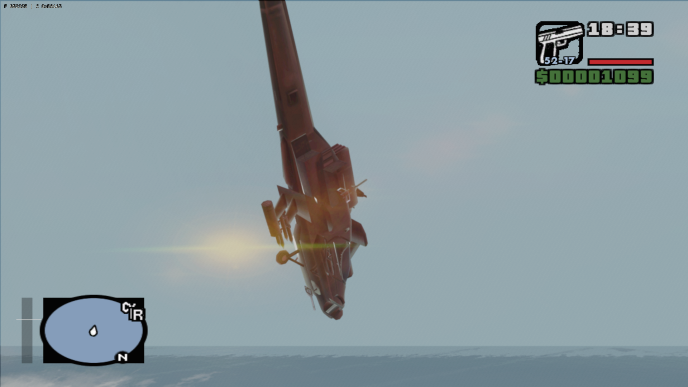

Aircraft over the San Fierro bay — PBR buildings and vehicle paint under an overcast sky with sea reflection mix:

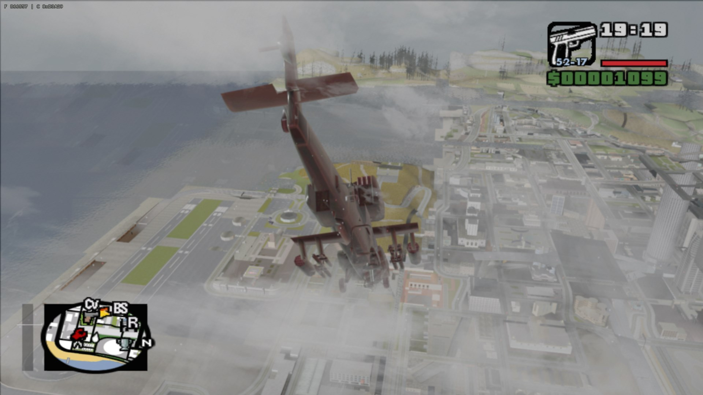

Daytime approach to Easter Basin — city skyline, shoreline foam band and haze falloff:

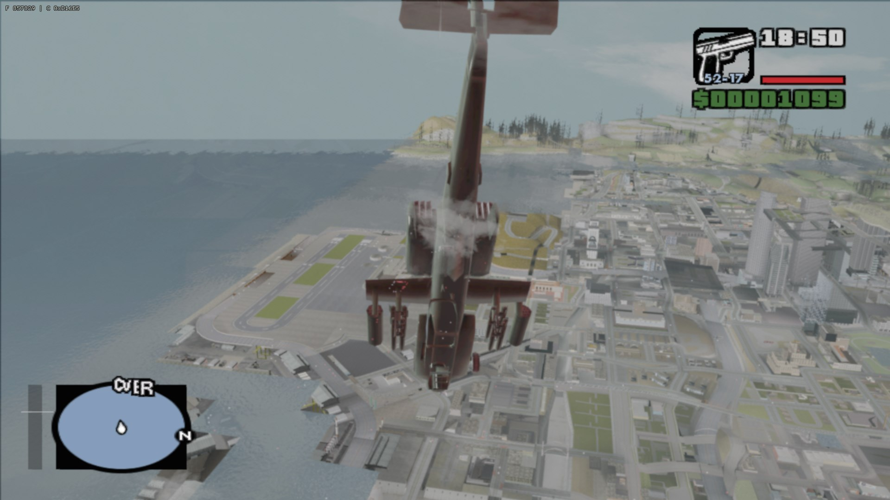

Downtown San Fierro and the airport strip from the air, mid-afternoon exposure:

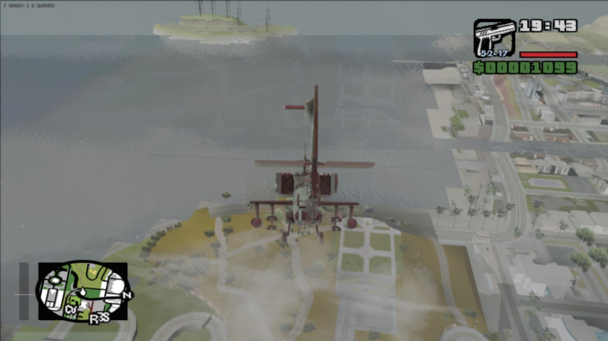

Coastal chimneys and the harbour — water clip-space work keeping the shoreline readable:

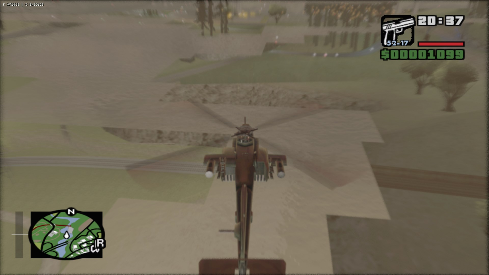

Airport perimeter at the pale end of auto-exposure (exposure mid-adjustment):

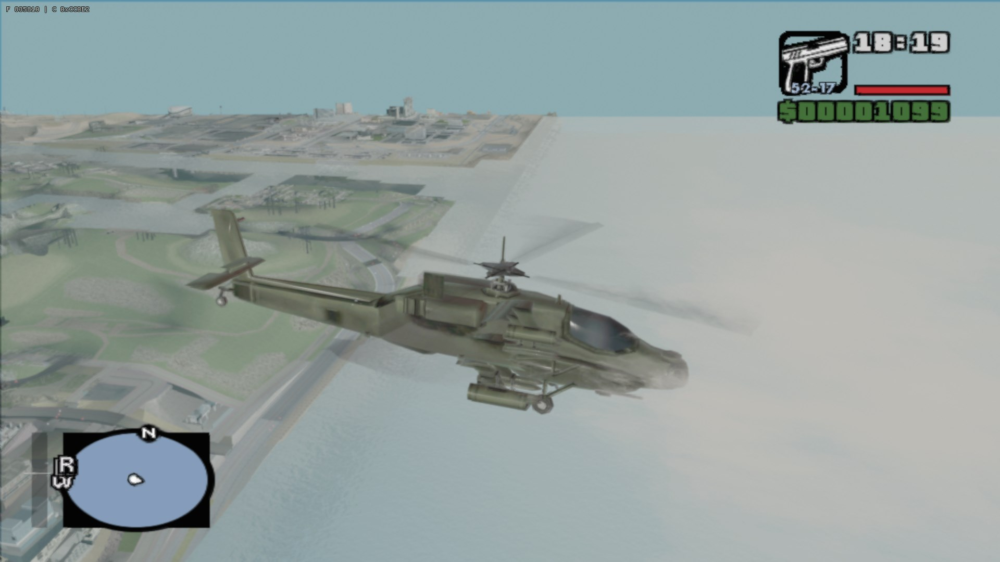

Runway district with the bay beyond — motion-blur velocity field at low altitude:

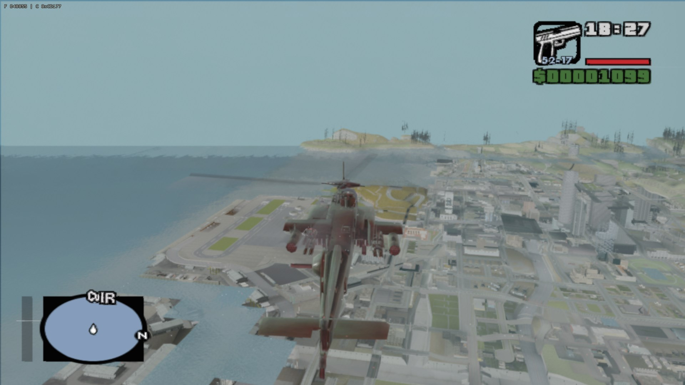

Dusk over Las Venturas — auto-exposure holding up the neon glow and street lights:

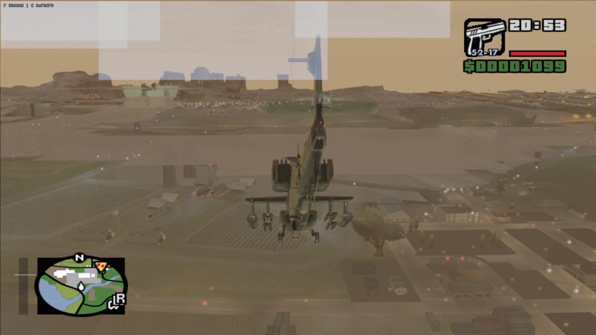

Countryside interchange with the hills behind — timecycle ambient boost on vegetation:

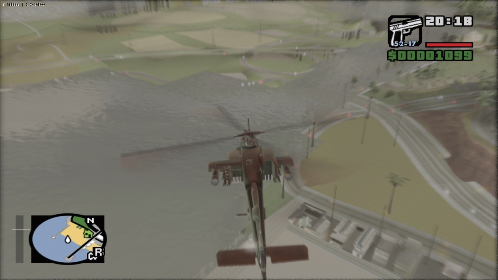

Rotor-blur freeze test — the camera identity gate in the motion-blur cut detector keeps secondary-camera velocity from smearing the main view:

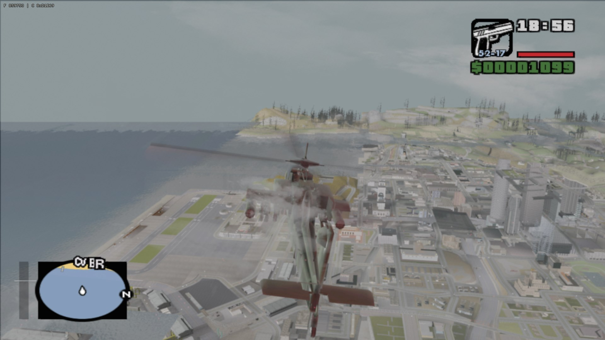

Whiteout capture: in-flight scene-state divergence, one of the standing known issues this branch works against (see Wave 12 notes — scene-start repair exists to kill exactly this class):

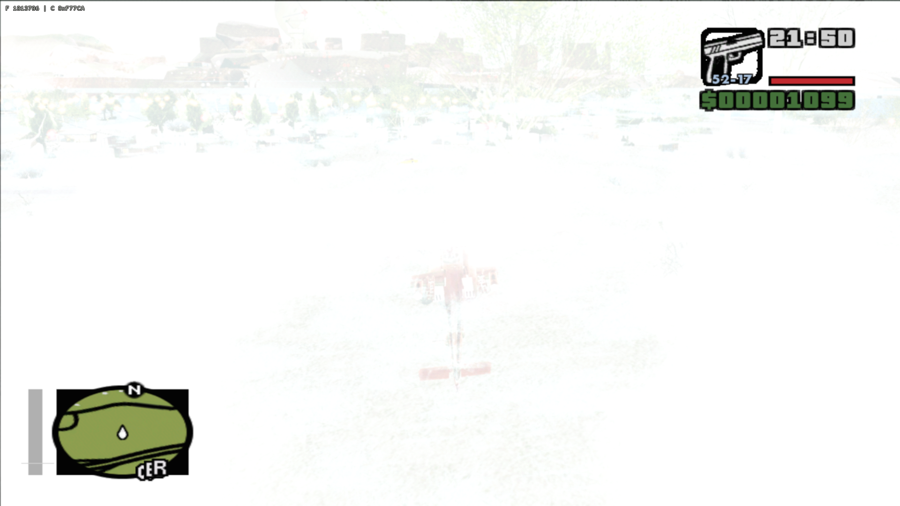

Note: the `screenshots/` folder doubles as a diagnostic dump (auto-synced by `tools/shot_sync.py`), so many captures there are intentionally-unhealthy frames used for regression archaeology rather than promo shots.

## Credits

- **Zeneric09** — the Zeneric skygfx fork this project is based on, extended heavily here
- **aap** — original [skygfx](https://github.com/aap/skygfx), the foundation of everything above
- **DK22Pac (SilentPatch)** — fixes and inspiration for the render-state discipline side
- **Rockstar Games / Take-Two / Rockstar North** — GTA San Andreas and the RenderWare 3.6 engine this hooks into
- **The open-source GTA SA reverse-engineering community** — [gta-reversed](https://github.com/gta-reversed/gta-reversed), [plugin-sdk](https://github.com/DK22Pac/plugin-sdk), and everyone who documented the game
- **Dear ImGui** — the in-game menu

## Disclaimer

This is an unofficial community mod. It is not affiliated with, endorsed by, or sponsored by Rockstar Games, Take-Two Interactive, or Rockstar North. Use of RenderWare and GTA San assets and trademarks belongs to their respective owners; this project only modifies the game at runtime on the user's own copy. Provided as-is, with no warranty — running an experimental graphics DLL in your game is, well, experimental.
