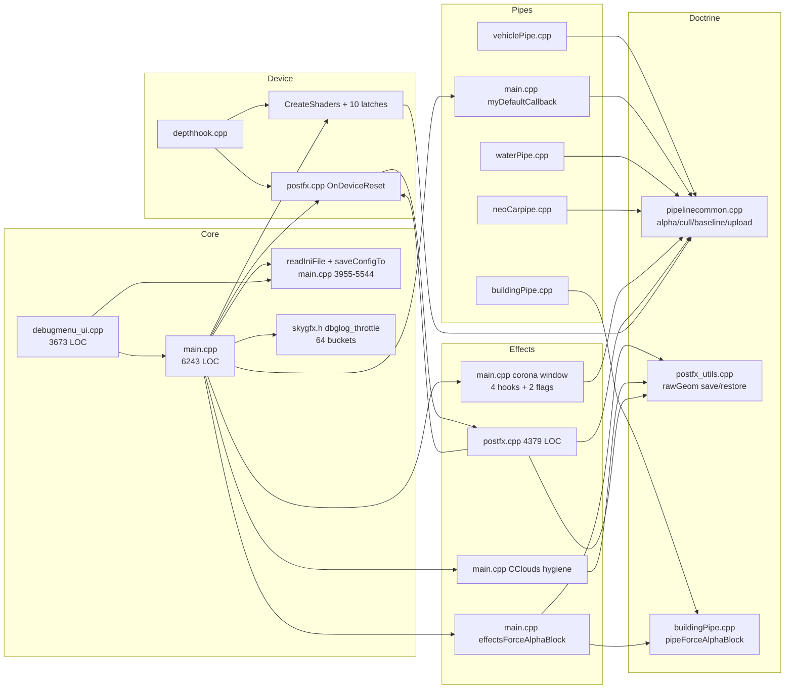

# Refactor Blueprint — per-file feature ownership and a single state doctrine

**Date:** 2026-10-24
**Repo:** `E:\dev(dave)\skygfx_plus_expIV`
**Scope:** 111 source files (64 `.cpp`, 47 `.h`), 173 active TUs in `build/skygfx.vcxproj`, 2 `ExcludedFromBuild`, 3 orphan `.cpp`, 99 embedded shader resources, 121 CSOs.
**Non-goal:** changing any visual result. Every step below must be pixel-identical unless explicitly stated.
**Line-number caveat:** refs are from the 2026-10-24 tree (`main.cpp` = 6243 lines). The working tree was changing during the audit; if a line drifts, re-anchor by the symbol name in the same sentence.

---

## 0. Executive summary

1. The repo's recurring failures are not feature bugs; they are **state-ownership bugs** produced by four cross-cutting mechanisms: the L1/L2/L3 state doctrine, the alpha/blend guard, the corona/sprite window, and shader/device-reset lifetime.
2. All four are implemented as paste-duplicated blocks in four to eight places. There are **4 copies of the canonical normal-alpha push**, **3 copies of the three-layer ZWRITE guard**, **4 copies of `blendToD3D`**, and **10 independent shader-load latches**.
3. The state doctrine lives in the right file (`pipelinecommon.cpp`) but its alpha half lives in `buildingPipe.cpp:525`, so the owner is wrong and every pipe re-implements the caller contract.
4. `main.cpp` (6243 lines, 127 hook/patch call sites) is simultaneously bootstrap, INI reader, INI writer, scene orchestrator, corona-state machine, ped pipe and debug harness. This is why a corona bug and a config bug look the same in logs.
5. Logging cannot currently attribute anything: **276 unique throttle tags are hashed into 64 buckets** (`skygfx.h:87-96`), so unrelated modules silently steal each other's throttle window.
6. Config has **436 fields, 1075 read/write sites, 4 INI writers and 5 clamp functions**, and modules write each other's fields. `colorFilterEnable` and `pipeline` already required self-healing guards (`main.cpp:494-603`, `postfx.cpp:1350`).
7. Device reset is a hardcoded list in `postfx.cpp:2264`; any new D3DPOOL_DEFAULT resource that is not manually appended is a latent `D3DERR_INVALIDCALL`.
8. Six TUs are dead or quarantined (`test.cpp`, `skygfx_bridge.cpp`, `SMAA.cpp`, `normalmap_plugin.cpp`, `menu_inject.cpp`, `HLSL_hook.cpp`), four shaders are orphaned, two normal-map implementations are compiled at once, and ~170 files are uncommitted (155 at audit start, 173 at audit end — the tree changed while it was being read).
9. Target: a `ModuleDesc` registry with `init/shutdown/onDeviceReset(pre,post)/onFrameStart/onSceneBegin/onSceneEnd/applyConfig`, one INI section, one kill switch, one log tag prefix and one state struct per module.
10. Target dependency rules are mechanically enforceable: only the doctrine TU may write render state; no module externs another module's mutable state; shaders are owned by their binder; hooks install only through a verified table.
11. Risk order for the next 7 days: **commit checkpoint → log-tag registry → doctrine extraction → corona module → hook registry → main.cpp carve → postfx/pipe splits → dead-code removal**. Config schema, normal-map merge and preset unification are explicitly post-Halloween.
12. Expected end state: `main.cpp` ≤1200 lines, 0 `d3d9device->SetRenderState` outside the doctrine (baseline 124 outside), 0 cross-TU mutable globals (baseline 67), 0 throttle-tag collisions (baseline ~4.3 tags/bucket), 1 shader-load path (baseline 10), 1 device-reset fan-out (baseline 1 hardcoded list).
13. The highest-ROI single change is **S2 (doctrine extraction)**: it removes the exact mechanism behind the black-corona, ghost-ped, missing-depth-building and translucent-vehicle classes.
14. The cheapest change is **S1 (log tags)**: ~220 LOC, and every later step becomes bisectable because each log line names its owner.
15. Nothing here requires rewriting shaders, changing hook addresses, or touching the pinned `Config` offsets.

---

## 1. Current pain map

### 1.1 The render-state model (the thing everything else fights)

The project implicitly uses a three-layer state model, documented only in prose scattered across `pipelinecommon.cpp`, `buildingPipe.cpp` and `main.cpp`:

| Layer | Owner | Behaviour |
|---|---|---|
| **L1** — RW cache | `RwRenderStateSet/Get` (RW 3.6, baked into the exe) | Value-compare gated; a set equal to the cached value is a **no-op** |
| **L2** — RW D3D9 driver cache | `RwD3D9SetRenderState`, `pending[]`/`applied[]`, flush `0x7FC200` | Also value-compare gated against `applied[]`; a set equal to the applied value never reaches L3 |
| **L3** — raw device | `d3d9device->SetRenderState` | Always writes, but **invisible to both caches** |

Because L1 and L2 skip on a cache hit, a single L3-only write (postfx raw restore, DepthHook `ZENABLE`, a fullscreen Im2D pass, the moon-mask helper) permanently splits the three layers. Every later "repair" that writes only L1 is then a double no-op, and the device keeps the stale value forever.

**Where the doctrine is implemented today**

| Primitive | Location | Notes |
|---|---|---|
| `pipeForceCullMode` / `pipeEnterCullMode` / `pipeExitCullMode` | `pipelinecommon.cpp:1231`, `:1260`, `:1285` | Correct owner, correct layers |
| `pipeEnterAlphaMode` / `pipeExitAlphaMode` | `pipelinecommon.cpp:1393`, `:1582` | Correct owner; `PipeAlphaState` also snapshots two raw-only states |
| `pipeApplyWorldBaseline` | `pipelinecommon.cpp:1687` | Frame-boundary canonical push |
| `pipeForceAlphaBlock` | **`buildingPipe.cpp:525` / `:531`** | Wrong owner (see P2) |
| `SaveRawGeomStates` / `RestoreRawGeomStates` | `postfx_utils.cpp:190`, `:245` | Nine-state park-and-set; used by 16 call sites |
| Duplicated entry contracts | `main.cpp:918-1213`, `buildingPipe.cpp:2378-2490`, `vehiclePipe.cpp:3047-3188` | Three near-identical save/force/restore blocks |
| Shader creation | `pipelinecommon.cpp:815` `CreateShaders` | One-shot latch, 7 callers, plus 9 module-local latch sites |

**Measured raw-state footprint (baseline for §7):**

- `d3d9device->SetRenderState`: **157** total. Inside `pipelinecommon.cpp`: 33. Outside doctrine: **124** — `main.cpp` 54, `vehiclePipe.cpp` 36, `buildingPipe.cpp` 17, `postfx.cpp` 6, `neoCarpipe.cpp` 5, `treeWind.cpp` 2, `postfx_utils.cpp` 2, `neoWaterdrops.cpp` 2.
- `d3d9device->SetSamplerState`: **50**, all outside the doctrine (`buildingPipe` 23, `vehiclePipe` 21, `main.cpp` 6).
- `d3d9device->SetTexture`: **22**. These are legitimate module-owned binds and should go through `pipeSetTexture` only for logging/ownership, not be centralised away.

### 1.2 Pain P1 — L1/L2/L3 drift is repaired 4 different ways

The same canonical block (blend on, SRCALPHA/INVSRCALPHA, BLENDOP ADD, ZWRITE on, ZTEST on, colour-write all, separate-alpha off) is hand-written at:

- `main.cpp:1833-1851` — sprite-flush window close.
- `main.cpp:3010-3039` — corona exit restore.
- `main.cpp:2421-2466` — `effectsForceAlphaBlock` canonical substitution + `pipeForceAlphaBlock`.
- `main.cpp:3532-3569` — `CClouds::Render` restore.
- `buildingPipe.cpp:2444-2456` — building Switch (via `pipeForceAlphaBlock(&savedAlpha)`).
- `vehiclePipe.cpp:3176-3184` — vehicle Switch re-asserts blend at L3 *again* after `pipeExitAlphaMode`, because `pipeExitAlphaMode` only restores L1+L2.

Each copy has a different subset of states, a different layer count, and its own log tag. This is why a state regression can look fixed in one pass and reappear in another.

### 1.3 Pain P2 — the alpha contract has no single owner

`pipeForceAlphaBlock` is declared twice in `main.cpp` (`:817`, `:2040`), once in `buildingPipe.cpp:522`, and defined in `buildingPipe.cpp:531`. Its comment says it is "the alpha half of `pipeForceCullMode`", but it does not live beside it. Consequences:

- `main.cpp:1038`, `buildingPipe.cpp:2456`, `vehiclePipe.cpp:3093`, `main.cpp:2072/2077` (skidmarks) call it with different expectations (some pass the pre-entry snapshot, some do not).
- The vehicle Switch adds a second L3 blend re-assert (`vehiclePipe.cpp:3176-3184`) that building does not have, and building adds `bpipeBlendLeakProbe` (`buildingPipe.cpp:2483`) that vehicle does not have.
- Any new pipe author must read three files to learn the contract.

### 1.4 Pain P3 — the corona/sprite window is a 4-hook state machine with no state machine

`main.cpp` contains a single logical subsystem spread over ~1400 lines and four hooks:

| Piece | Location | Purpose |
|---|---|---|
| Window flags | `main.cpp:1654-1672` (`g_inCoronasRender`, `g_coronaBodyDone`, pre-window capture) | The entire state |
| Per-draw raw shield | `main.cpp:1690-1752` | Park-and-set every blend/Z state before each rasterisation |
| Sprite draw wrapper | `main.cpp:1761-1777` | Calls the shield before `0x70E780` |
| Buffered-flush hook | `main.cpp:1807-1857` | Shield + window close + canonical resync |
| `CPointLights::Render` re-arm | `main.cpp:1884-1899` | Re-opens the window for the lamp-cone batch |
| Frame-boundary close | `main.cpp:1910-1924` | Safety net + alpha func/ref restore |
| `CCoronas::Render` entry shield | `main.cpp:2809-2970` | Entry park-and-set + capture + trampoline |
| `CCoronas::Render` exit restore | `main.cpp:2985-3040` | Canonical restore |
| Hook install + byte verify | `main.cpp:5970-6039` | Two flush sites + point-lights site |

The timing is not vanilla: SilentPatchSA rewrites the corona tail-jump to `RET`, so the batch flushes after `CCoronas::Render` returns (documented at `main.cpp:1789-1802`). Under MoonLoader, the same subsystem may behave differently. There is no enum, no transition log, no kill switch, and four tags (`corona_draw`, `corona_shield`, `corona_exit`, `corona_resync`) for one window.

### 1.5 Pain P4 — shader lifetime is split between a god function and 10 latches

`CreateShaders` (`pipelinecommon.cpp:815-1005`) creates 74 handle slots in one function. It is called from **7 places**:

- `buildingPipe.cpp:2756`, `:2787` (pipe creation)
- `depthhook.cpp:372` (after Reset)
- `neoCarpipe.cpp:465` (`CarPipe` ctor)
- `postfx.cpp:4353` (`CPostEffects::Initialise`)
- `vehiclePipe.cpp:239`

It is guarded by one `static bool shadersCreated` and a `s_forceShaderRecreate` flag. Independent lazy loaders exist in:

| Loader | Latch | Reset-aware? |
|---|---|---|
| `Pipeline_GetCustomBuildingVS/NormMapBuildingPS/NormMapVehiclePS/VectorMotionBlurPS/SkinSSSPS` | `pipelinecommon.cpp:728-800` (5 `attempted` statics) | No |
| `postfx_newfx.cpp:87-113` `FxLoadShaders` | `s_fxLoadTried` | **No** — after a device Reset it returns dead pre-Reset handles |
| `postfx_underwater.cpp:284` | module-local one-shot | No |
| `mirrorPass.cpp:117` | module-local one-shot | No |
| `PC_GrassInstancer.cpp:97-...` | local clone of `makePS` | No |

`Pipeline_InvalidateShaders` (`pipelinecommon.cpp:808`) only clears the `CreateShaders` latch. The 9 module-local latches (5 getters + 4 loaders) survive Reset with dangling `IDirect3DPixelShader9*`. This is a latent post-alt-tab black-screen class that no current log can attribute.

### 1.6 Pain P5 — config is a shared mutable bag with five writers

`Config` has **436 fields** (`skygfx.h:260-846`), referenced **1075 times across 33 files**. There is no ownership map.

Writers:

| Writer | Location | Keys |
|---|---|---|
| `readIniFile` | `main.cpp:3955-5105` | 250 `cfg.get`, plus 106 `ADD_IF_MISSING` defaults |
| `saveConfigTo` | `main.cpp:5173-5544` | 366 `cfg.set` |
| `MenuWriteMissingIniKeys` | `debugmenu_ui.cpp:3286-3306` | 11 keys the main saver "forgets" |
| `BuildIniClipboard` | `debugmenu_ui.cpp:3225` | Clipboard save (third schema) |
| Debug menu rows | `debugmenu_ui.cpp` (576 `config->` refs) | Direct field writes |
| `derivePipelineFromPipes` | `main.cpp:604`, called every frame from `postfx.cpp:1350` | Repairs other writers |

Five clamp functions (`main.cpp:358`, `:382`, `:448`, `:464`, plus inline clamps `:4524-4532`) must each be called from load, reload *and* save. Adding a field means edits in 4-6 places. The `colorFilterEnable` silent-stomp incident and the `pipeline` every-frame re-derivation are symptoms, not causes.

`readIniFile` also **writes the INI on every load** (`main.cpp:5093`) to inject defaults. Combined with `linb::ini` merge-on-save, the on-disk file is a derived artifact, not user intent.

### 1.7 Pain P6 — logging cannot attribute anything

`dbglog_throttle` (`skygfx.h:87-96`) and `dbglog_first` (`:99-107`) hash tags into **64 static buckets**. There are **276 unique throttle tags** (`rg 'dbglog_throttle' | sort -u`). That is ~4.3 tags per bucket on average, so any two unrelated modules can collide; the general tag `"fx"` alone is reused 10 times for unrelated messages. A throttled log you need may be suppressed because a different module fired 1.9 s ago.

`dbglog_throttle` is used at 310 call sites (`dbglog_first` at 10) across those 276 tags; there is no tag registry, no module prefix rule, and no collision report.

### 1.8 Pain P7 — hook installation is 127 inline calls with silent failure

`main.cpp` contains **127** `InjectHook`/`InterceptCall`/`Patch`/`Nop` calls across `DllMain` (`:5901-6243`) and `InjectDelayedPatches` (`:5694-5899`). Only the corona flush sites verify bytes (`main.cpp:5970-6039`); the rest rely on `InterceptCall` being silent on a bad site. `src/core/hooks.h` declares `InstallAllHooks()` and `src/core/main_exports.h` refers to a `hooks.cpp` that **does not exist**.

### 1.9 Pain P8 — device reset is a hardcoded list

`depthhook.cpp:329` `hook_Reset` calls `OnDeviceReset` (`postfx.cpp:2264`), which manually releases 12 modules' resources in a fixed order (`postfx.cpp:2159-2262`). Anything new that allocates D3DPOOL_DEFAULT must be manually appended. Recent bug history (the `CRITICAL-1` comment at `postfx.cpp:2245-2248`) is exactly this failure. `TexAlpha_OnDeviceReset`, `chars_OnDeviceReset`, `InvalidateCameraRasterCache`, `Pipeline_InvalidateShaders` and `CoronaWindow_Close` are also called by hand from the same function.

### 1.10 Pain P9 — two normal-map implementations are compiled at once

- `src/rw/normalmap.cpp` (368 lines): the DK22Pac-style full plugin, `normalmap_init()` at engine init, installs pipelines.
- `src/render/normalmap.cpp` (280 lines): the NM lane, texture pairing + gloss-in-alpha, `nmInitHooks()`.
- `src/rw/normalmap_plugin.cpp` (1314 lines): not compiled (`vcxproj:248`), abandoned rewrite.
- `src/rw/normmap_stubs.cpp` (87): stubs for `rpnormmap.lib`.

Both live implementations attach RW plugins and both are called from startup (`main.cpp:5771`, `main.cpp:6130`). The vcxproj needs a per-file `ObjectFileName` to stop the basename collision (`vcxproj:186-189`) — the build file itself documents the hazard. Which implementation wins depends on hook order.

Related orphan shaders:

| Shader | Resource | Created | Bound |
|---|---|---|---|
| `PBR_Lighting.hlsl` | `IDR_PBR_LIGHTING` 207 | `pipelinecommon.cpp:884` | **never** |
| `pedPBRVS.hlsl` | `IDR_PEDPBRVS` 275 | **never** (`CreateShaders` has no `makeVS`) | never |
| `SkinSSS.hlsl` | `IDR_SKINPBR` 210 | lazily via `Pipeline_GetSkinSSSPS` (`:789`) | never (no caller) |
| `Rubber_Vehicle.hlsl` (standalone) | `IDR_RUBBER_VEHICLE` 205 | `pipelinecommon.cpp:881` | used only as a boolean gate (`vehiclePipe.cpp:2329`); the bound shader is `Rubber_Vehicle_Modern` |

### 1.11 Who touches what



Text tree of the same dependency (arrow = "calls into"):

```
main.cpp ──> pipelinecommon (alpha/cull/baseline/upload)
   │            ↑
   ├──> buildingPipe ──> pipelinecommon
   │        └── pipeForceAlphaBlock (defined here, called from main + vehicle)
   ├──> vehiclePipe ──> pipelinecommon + buildingPipe's alpha contract
   ├──> myDefaultCallback (ped) ──> pipelinecommon + raw L3
   ├──> corona window ──> pipelinecommon + raw L3 (4 hooks)
   ├──> effectsForceAlphaBlock ──> buildingPipe::pipeForceAlphaBlock + postfx globals
   ├──> CClouds hygiene ──> postfx_utils rawGeom
   ├──> postfx.cpp ──> postfx_utils + pipelinecommon + depthhook + newfx/ssao/smaa
   ├──> depthhook.cpp ──> postfx::OnDeviceReset ──> 12 manual releases ──> main.cpp caches
   └──> readIniFile/saveConfigTo ──> every module (no ownership)
```

### 1.12 Failure-to-owner map (what a log line should have said)

| Symptom seen in field | Actual mechanism | Current files | Should belong to |
|---|---|---|---|
| Black corona / traffic-light quads | L3 parked on REPLACE behind unchanged caches | `main.cpp:1690`, `:2354` | `effects/sprite` |
| Ghost props/pickups after coronas | additive ONE/ONE leaked past corona exit | `main.cpp:3010`, `:2421` | `effects/sprite` |
| Peds visible through buildings | ped cb drew with ZWRITE off (device only) | `main.cpp:1017-1055` | `ped` |
| Far geometry overdraws near | building cb trusted L1 ZWRITE | `buildingPipe.cpp:2383` | `building` |
| Translucent vehicle shells | alpha-test off / ref 0 at L3 on vehicle entry | `vehiclePipe.cpp:3053` | `vehicle` |
| Black sky dome, interiors fine | previous frame's postfx PS still bound at `CClouds` | `main.cpp:3488`, `:3553` | `effects/sky` |
| Black screen after alt-tab | newfx/mirror/underwater shaders are dead post-Reset | `postfx_newfx.cpp:87`, `mirrorPass.cpp:117` | `postfx` / `mirror` |
| `D3DERR_INVALIDCALL` on Reset | unregistered D3DPOOL_DEFAULT resource | `postfx.cpp:2264` | each module |
| Config changes revert | another writer + every-frame re-derivation | `main.cpp:604`, `postfx.cpp:1350` | `core/config` |
| A log line "never fires" | throttle-bucket collision | `skygfx.h:87` | `core/log` |
| Hook silently not installed | `InterceptCall` bad site, no verify | `main.cpp:5901+` | `core/hooks` |
| Wrong normal map / double plugin | two implementations attached | `rw/normalmap.cpp`, `render/normalmap.cpp` | `normalmap` |

---

## 2. Target architecture

### 2.1 Module interface

One header, `src/core/module.h`, is the contract. It must remain POD-only and exception-free; callbacks are invoked inside a POD-only SEH shim.

```cpp
#pragma once
struct Config;

enum ModulePhase {
    MOD_BOOT, MOD_SHUTDOWN,
    MOD_DEVICE_PRE, MOD_DEVICE_POST,
    MOD_FRAME_START, MOD_SCENE_BEGIN, MOD_SCENE_END,
    MOD_CONFIG_APPLY, MOD_DEBUG_DRAW
};

// Returns false to quarantine the module for this session.
typedef bool (*ModInitFn)(void);
typedef void (*ModVoidFn)(void);
typedef void (*ModApplyFn)(Config *c);
typedef bool (*ModGateFn)(const Config *c);   // reads ONLY its own section/kill switch
typedef void (*ModDebugFn)(void);

struct ModuleDesc {
    const char *name;         // "building"  — unique, lowercase, ASCII
    const char *iniSection;   // "Building"  — unique
    const char *logPrefix;    // "bld"       — every tag starts with this + '.'
    int         order;        // 10,20,...   — ascending; unique
    ModGateFn   enabled;      // NULL = always enabled
    ModInitFn   init;
    ModVoidFn   shutdown;
    ModVoidFn   onDeviceResetPre;    // release GPU resources
    ModVoidFn   onDeviceResetPost;   // recreate eager resources; bump resetEpoch
    ModVoidFn   onFrameStart;
    ModVoidFn   onSceneBegin;
    ModVoidFn   onSceneEnd;
    ModApplyFn  applyConfig;
    ModDebugFn  drawDebug;    // optional imgui tab; may be NULL
};

void Modules_Register(const ModuleDesc *m);
void Modules_Seal(void);                 // asserts unique name/section/order; call once
void Modules_Boot(void);                 // init in order; failure quarantines, never aborts
void Modules_Shutdown(void);
void Modules_ApplyConfig(Config *c);     // increments a global config generation
void Modules_DeviceReset_Pre(void);
void Modules_DeviceReset_Post(void);
void Modules_FrameStart(void);
void Modules_SceneBegin(void);
void Modules_SceneEnd(void);
void Modules_DrawDebug(void);
void Modules_DumpStatus(void);           // one line per module into the log
int  Modules_Count(void);
unsigned Module_ConfigGeneration(void);
unsigned Module_ResetEpoch(void);
```

`Modules_*` lives in `src/core/module_registry.cpp`. Each callback is invoked through:

```cpp
// POD-only wrapper; no C++ objects with destructors in scope (C2712-safe).
static void InvokeVoid(ModuleDesc *m, ModVoidFn fn, ModulePhase ph);
```

On fault: increment `faults`, record `lastFault = GetExceptionCode()`, log
`[module] name=building phase=SCENE_END fault=0xC0000005 quarantined=1`, and skip that module for 300 frames. This is the per-feature attribution mechanism: a crash in one module no longer takes down the frame for every other module, and the log names the owner.

### 2.2 Lifecycle order

| Phase | Core does first | Ordered module callbacks |
|---|---|---|
| DLL attach | diag/log, version check, module registration | `Modules_Seal`, then `Modules_Boot` |
| Config load/reload | parse into `Config` | `Modules_ApplyConfig` in `order` |
| Frame start | `pipeApplyWorldBaseline("frame")`, sprite window close | `onFrameStart` |
| Scene begin | camera raster validation, forward+ cull | `onSceneBegin` |
| Scene end | ragdoll pose commit, env map refresh | `onSceneEnd` |
| Device Reset | `Modules_DeviceReset_Pre`, doctrine invalidates all shader handles | `onDeviceResetPre` |
| Reset done | `Modules_DeviceReset_Post` | `onDeviceResetPost` |
| Frame end | `DrawFinalEffects_pf` | `onSceneEnd` is already done; no new phase |

The doctrine owns the two frame boundaries (`pipeApplyWorldBaseline`, `CoronaWindow_Close`). No module may call them directly except through the registry.

### 2.3 Module list (target)

| Order | Module | Owner TUs (after refactor) | INI section | Kill switch |
|---|---|---|---|---|
| 10 | `texdb` | `texture/texdb.cpp` | `[TexDB]` | `enabled` |
| 20 | `texalpha` | `texture/texalpha.cpp` | `[TexAlpha]` | `enabled` |
| 30 | `normalmap` | `normalmap/normalmap.cpp` | `[NormalMap]` | `enabled` |
| 40 | `weather` | `sky/weather.cpp` | `[Weather]` | `enabled` |
| 50 | `depth` | `render/depth.cpp` (depthhook) | `[Depth]` | `enabled` |
| 60 | `reflection` | `render/reflection.cpp` (envmap) | `[Reflection]` | `enabled` |
| 70 | `building` | `building/{module,ps2,xbox,pbr,sphere,resentry}.cpp` | `[Building]` | `enabled` |
| 80 | `vehicle` | `vehicle/{module,ps2,xbox,spec,env,gtaiv,resentry}.cpp` + data | `[Vehicle]` | `enabled` |
| 90 | `ped` | `ped/{module,default_cb,chars}.cpp` | `[Ped]` | `enabled` |
| 100 | `water` | `water/{module,pipe,underwater,waterdrops}.cpp` | `[Water]` | `enabled` |
| 110 | `effects` | `effects/{module,sprite_shield,clouds,skidmarks,moon}.cpp` | `[Effects]` | `enabled` |
| 120 | `mirror` | `render/mirror.cpp` | `[Mirror]` | `enabled` |
| 130 | `tree` | `vegetation/tree.cpp` | `[Tree]` | `enabled` |
| 140 | `forwardplus` | `render/forwardplus.cpp` | `[ForwardPlus]` | `enabled` |
| 150 | `postfx` | `postfx/{chain,colourfilter,tonemap,radiosity,ibl,atmos,newfx}.cpp` | `[PostFX]` | `enabled` |
| 160 | `ssao` | `postfx/ssao.cpp` | `[SSAO]` | `enabled` |
| 170 | `smaa` | `postfx/smaa.cpp` | `[SMAA]` | `enabled` |
| 180 | `motionblur` | `postfx/motionblur.cpp` | `[MotionBlur]` | `enabled` |
| 190 | `profiler` | `core/profiler.cpp` | `[Profiler]` | `enabled` |
| 200 | `debugui` | `debugui/*.cpp` | `[Debug]` | `enabled` |

`doctrine` (`render/state_doctrine.cpp`) and `core` are not feature modules; they are the only code allowed to bypass a module gate.

### 2.4 Dependency rules (normative, mechanically checkable)

**R1 — State writes.** Only `src/render/state_doctrine.cpp` (and the RW reimplementation under `src/rw/`, which *is* the layer) may call `RwRenderStateSet`, `RwD3D9SetRenderState`, or `d3d9device->SetRenderState`. Everything else calls `pipeSet*`, `pipeForce*`, `pipeEnter*/pipeExit*`, `pipeApplyWorldBaseline`, `pipeSave*/pipeRestoreRawGeom`.
Allowlisted exceptions (documented in the file header): resource creation/destruction, `SetTexture`/`SetSamplerState` when the module owns the shader that samples it (`pipeSetTextureOwned` wrapper), `Clear`, `SetRenderTarget` via `guardedSetRT`.

**R2 — State ownership.** No module `extern`s another module's mutable state. Cross-module data is either `const` or an accessor in `*_api.h`. Target: every file-scope mutable static becomes a field of `XxxState` in that module's TU.

**R3 — Shaders.** A shader handle belongs to the module that binds it. Creation goes through `ShaderLib_Get(owner, IDR_..., ShaderKind)`. `ShaderLib_InvalidateAll()` on device reset drops every handle; each module recreates lazily on its next bind. No lazy loader may cache a handle across a reset epoch.

**R4 — Config.** Modules read `Config`; they never write it. Writes happen only in `core/config_io.cpp`, `core/config_validate.cpp`, and `debugui` (through `ConfigField` descriptors). One field = one descriptor = one parse path = one save path.

**R5 — INI.** Each module owns exactly one section and one `enabled` key. Legacy `[SkyGfx]` keys are read-only fallbacks for one release. No module writes another section.

**R6 — Hooks.** Installation only through `Hooks_Install(stage)` with a `HookDesc` that names the owner module and, where possible, the expected opcode/target. Inline `InjectHook`/`InterceptCall` outside `core/hooks_registry.cpp` is a build-gate failure.

**R7 — Dispatch.** `main.cpp` orchestrates only: DllMain, registry boot, scene/frame boundaries. It does not implement corona state, ped rendering, INI parsing or config clamps.

**R8 — Logging.** Every tag is `"<logPrefix>.<event>"` (`bld.zwrite`, `fx.corona_entry`). Tags are registered; collisions are a startup error in debug builds.

**R9 — Device reset.** A module that allocates D3DPOOL_DEFAULT must register a `GpuRes` entry in debug builds and implement `onDeviceResetPre`. The registry logs outstanding-by-owner before/after.

**R10 — Feature kill switches.** `enabled=0` must make the module's hooks pass through and perform zero D3D calls/state writes. `[Core] safeMode=1` boots only `core` + `doctrine` + `debugui` for bisection.

Enforcement: `tools/layering_check.py` (new, ~120 LOC) greps for violations and exits non-zero; wire it into `tools/fast_build.py` before MSBuild.

### 2.5 Hook registry

```cpp
// src/core/hooks_api.h
enum HookKind { HK_JUMP, HK_CALL, HK_PATCH_BYTES, HK_NOP, HK_VTABLE };

struct HookDesc {
    const char *owner;         // ModuleDesc.name
    const char *what;          // "CCoronas::Render entry"
    unsigned    stage;         // HK_STAGE_EARLY | GAME_INIT | POST_INIT
    uintptr_t   site;
    void       *detour;
    void      **trampoline;
    HookKind    kind;
    unsigned    expectedOpcode; // 0 = no check
    uintptr_t   expectedTarget; // 0 = no check (for HK_CALL)
};

void Hooks_Install(unsigned stage);   // verified, logged, idempotent
void Hooks_DumpTable(void);           // owner/site/status, one line each
bool Hooks_SuspendOwner(const char *owner); // kill-switch path
```

Every existing install moves into three static tables. The verification logic currently inlined for the corona flush sites (`main.cpp:5970-6039`) becomes the generic path:

- `HK_CALL`: read opcode; must be `0xE8`; decode rel32; must equal `expectedTarget`; else log `[hooks] MISMATCH owner=effects site=0x70CF62` and skip.
- `HK_JUMP`: record stolen length; log the bytes replaced.
- `HK_PATCH_BYTES`/`HK_NOP`: record original bytes in the table for audit.

`Hooks_DumpTable()` is printed at startup and shown in the debug menu's "Hooks" tab. Target: 127 inline call sites → 127 table rows, 0 inline calls.

### 2.6 Config model

Keep `Config` flat and byte-layout-stable. Do **not** reorder fields: `static_assert` at `skygfx.h:847-849` pins `version`/`fixGrassPlacement`/`doglare`, and the naked asm in `main.cpp` reads those offsets.

Add a descriptor table:

```cpp
enum FieldType { FT_INT, FT_BOOL, FT_FLOAT, FT_ENUM, FT_COLOR3 };

struct ConfigField {
    const char *section;      // "Building"
    const char *key;          // "bldEnvReflect"
    const char *legacyKey;    // "bldEnvReflect" (old flat [SkyGfx] key) or NULL
    size_t      offset;       // offsetof(Config, bldEnvReflect)
    FieldType   type;
    float       lo, hi;
    int         def;
    const char *const *enumNames; int enumCount;
    const char *owner;        // ModuleDesc.name
    const char *help;
};

extern const ConfigField kConfigFields[];
extern const int kConfigFieldCount;   // must equal 436 at seal (static_assert via script)
```

- **Parse:** for each descriptor, `[section] key` → else `[SkyGfx] legacyKey` → else `def`. This is the *only* reader.
- **Save:** for each descriptor, write `[section] key`. Unknown keys in the file are preserved by `linb::ini`. This is the *only* writer.
- **UI:** the debug menu iterates descriptors filtered by the active tab and by `owner`. Rows show the help string and clamp range. No hand-written `config->field` row can drift from the parser.
- **Migration:** on first load, if the section is absent and the legacy key exists, read it and log `[config] migrated key=bldEnvReflect from [SkyGfx]`. After one release, drop legacy keys.
- **Delete:** `ADD_IF_MISSING` ×106 (`main.cpp:4969-5095`), `MenuWriteMissingIniKeys` (`debugmenu_ui.cpp:3286`), the separate clamp call sites (fold `lo/hi` into the descriptor), and `BuildIniClipboard`'s ad-hoc list.

Section map (first release):

| Section | Module | Example keys |
|---|---|---|
| `[Core]` | core | `pipeline`, `pipelineOverride`, `preset`, `safeMode`, `configVersion` |
| `[Building]` | building | `buildingPipe`, `bldEnvReflect`, `bldSkyReflect`, `detailMaps`, `stochastic`, `zwriteThreshold` |
| `[Vehicle]` | vehicle | `vehiclePipe`, `vehPBRLayers`, `vehEnv*`, `chrome*`, `normalMapPlayerOnly` |
| `[Ped]` | ped | `pedShadows`, `sssEnable`, `sssSkinIntensity`, `skinEnhance*` |
| `[Water]` | water | `water*`, `waterStyle`, `waterQuality`, `waterUnderwaterFog` |
| `[Effects]` | effects | `coronaZtest`, `stateBaselineEnable`, `spriteShield`, `vcsTrails`, `grainFilter` |
| `[PostFX]` | postfx | `colorFilter`, `tonemap*`, `bloom*`, `dof*`, `iv*`, `postfx*` |
| `[SSAO]` | ssao | `ssao*` |
| `[SMAA]` | smaa | `smaaEnable` |
| `[ForwardPlus]` | forwardplus | `forwardPlusEnable`, `forwardPlusDebug` |
| `[Weather]` | weather | `usePCTimecyc`, `altTimecycEnable`, sky/sun/cloud keys |
| `[TexDB] [TexAlpha] [NormalMap] [Depth] [Reflection] [Mirror] [Tree] [Profiler] [Debug] [MotionBlur]` | per module | `enabled` + module keys |

### 2.7 State authority map

| State | Single owner after refactor | Access |
|---|---|---|
| L1/L2/L3 render state | `state_doctrine.cpp` | `pipe*` API only |
| Shader handles | per module `XxxState.shaders` | `ShaderLib_Get(owner,...)` |
| `Config` | `core/config_io.cpp` (write) / readers | `const Config*` in modules |
| INI schema | `kConfigFields` | generated parse/save/UI |
| Corona window flags | `effects/sprite_shield.cpp` | `Sprite_*` API; no externs |
| Device-reset generation | `module_registry.cpp` | `Module_ResetEpoch()` |
| Camera-raster repair cache | `core/scene_hooks.cpp` | `CameraRaster_*` API |
| `g_iblTex` / IBL capture | `postfx/ibl.cpp` | `Ibl_Texture()` accessor |
| Forward+ textures | `forwardplus.cpp` | `ForwardPlus_*` API |
| Normal-map slots | `normalmap/normalmap.cpp` | `nm*` API |
| Texture-alpha cache | `texalpha.cpp` | `TexAlpha_Classify` |

### 2.8 Device reset contract

```
depthhook::hook_Reset
  1. Modules_DeviceReset_Pre()
       -> doctrine: ShaderLib_InvalidateAll() (drops every handle, bumps resetEpoch)
       -> in module order: onDeviceResetPre()   [release DEFAULT pool, RW rasters, caches]
       -> debug: GpuRes_DumpOutstanding(phase="pre")
  2. orig_Reset()
  3. clear RW shader bookkeeping (0x8E2448/0x8E244C)
  4. Modules_DeviceReset_Post()
       -> in reverse order: onDeviceResetPost() [mark caches dirty; eager re-create only if needed]
  5. pipeApplyWorldBaseline("DeviceReset")
  6. GpuRes_DumpOutstanding(phase="post")   // must be 0 for every owner
```

`GpuRes` is debug-only bookkeeping:

```cpp
void GpuRes_Register(const char *owner, void *ptr, const char *kind); // CreateTexture/Surface/Raster
void GpuRes_Unregister(void *ptr);
int  GpuRes_Outstanding(const char *owner);
void GpuRes_DumpOutstanding(const char *phase);
```

Registered at creation and release points that already exist; the ledger is compile-gated behind `_DEBUG` so the release build pays nothing.

### 2.9 Module skeleton (what a new feature looks like)

```
src/<module>/
  module.cpp        // ModuleDesc + state struct + init/shutdown/reset/applyConfig
  <feature>.cpp     // implementation, includes only <module>_api.h + doctrine
  <feature>.h       // private
  <module>_api.h    // const accessors only; no mutable externs
  shaders.h         // static const ShaderId list owned by this module
```

`module.cpp` template:

```cpp
#include "core/module.h"
#include "core/config.h"
#include "render/state_doctrine_api.h"
#include "<module>_api.h"

struct BuildingState {
    void *ps2VS, *pbrVS, *pbrPS;     // owned handles
    int   cfgGeneration;
    unsigned resetEpoch;
    int   faults;
};
static BuildingState s_bld;

static bool IsEnabled(const Config *c){ return c && c->buildingEnabled; }

static bool Init(void){ /* register shaders by name; no world access */ return true; }
static void Shutdown(void){ /* drop non-GPU resources */ }
static void ResetPre(void){ /* release DEFAULT-pool resources; ShaderLib does handles */ }
static void ResetPost(void){ s_bld.resetEpoch = Module_ResetEpoch(); }
static void ApplyConfig(Config *c){ s_bld.cfgGeneration = (int)Module_ConfigGeneration(); }
static void SceneBegin(void){ /* per-frame setup; no frame-boundary state pushes */ }

static const ModuleDesc kBuildingModule = {
    "building", "Building", "bld", 70,
    IsEnabled, Init, Shutdown, ResetPre, ResetPost,
    nullptr, SceneBegin, nullptr, ApplyConfig, nullptr
};
REGISTER_MODULE(kBuildingModule);   // static-init registration OR explicit list in registry
```

`REGISTER_MODULE` should be an explicit list in `module_registry.cpp`, not static initialisers (ASI load order is not guaranteed and MSVC may dead-strip). One array, one order, auditable.

---

## 3. File-by-file disposition

Legend: **K** keep, **S** split, **M** merge, **D** delete, **Q** quarantine (keep on disk, exclude from build), **Mv** move/rename.

### 3.1 `src/core` (13 files)

| File | LOC | Disposition | Target |
|---|---|---|---|
| `main.cpp` | 6243 | **S** into 7 | `core/bootstrap.cpp` (DllMain 5901-6243, version check), `core/config_io.cpp` (3862-3954, 3955-5105, 5109-5170, 5173-5544, 5564-5575), `core/config_validate.cpp` (296-700), `effects/sprite_shield.cpp` (1633-1930, 2757-3060), `effects/effects_state.cpp` (2354-2467, 2616-2685, 3386-3570), `ped/ped_pass.cpp` (164-289, 833-852, 894-1218), `core/scene_hooks.cpp` (2080-2304, 3578-3648), `core/debug_probes.cpp` (868-884, 3110-3345), `game/game_hooks.cpp` (1224-1660, 1930-2080, 3751-3850) |
| `skygfx.h` | 1418 | **S** into 5 | `core/config.h` (Config 260-846 + static_asserts 847-852), `core/globals.h` (pipeline enums 148-232), `render/state_doctrine_api.h` (PipeAlphaState, pipe*), per-module `*_api.h` (shader externs move out) |
| `debugmenu_ui.cpp` | 3673 | **S** into 6 | `debugui/{core,building,vehicle,postfx,water,debug}.cpp`; `debugui/config_rows.cpp` generated from `ConfigField` (delete 576 direct writes over time) |
| `modeManager.cpp` | 294 | **M** | `core/modes.cpp` |
| `presets.cpp` | 155 | **M** | `core/modes.cpp` |
| `diagnostics.cpp` | 346 | **K** + extend | `core/log.cpp` (tag registry, VEH, ring) |
| `diagnostics.h` | 32 | **K** | `core/log.h` |
| `crashhandler.cpp` | 254 | **K** | `core/crash.cpp` (no refactor before Halloween) |
| `menu_inject.cpp` | 429 | **Q/D** | `experimental/pause_menu.cpp`; init is already disabled (`main.cpp:5853`) |
| `test.cpp` | 47 | **D** | `dumpMenu` has zero callers |
| `weather.cpp` | 466 | **Mv** | `sky/weather.cpp` |
| `weather.h` | 13 | **Mv** | `sky/weather.h` |
| `hooks.h` | 27 | **D** | declares `InstallAllHooks`; no implementation exists |
| `main_exports.h` | 36 | **D** | refers to nonexistent `hooks.cpp`; symbols move to module APIs |

### 3.2 `src/render` (39 files)

| File | LOC | Disposition | Target |
|---|---|---|---|
| `pipelinecommon.cpp` | 1751 | **S** into 4 | `render/state_doctrine.cpp` (cull/alpha/baseline/rawGeom: 1231-1751 + move `pipeForceAlphaBlock` from buildingPipe), `render/shader_lib.cpp` (665-1005), `render/lighting.cpp` (64-300, 477-664), `render/pipe_upload.cpp` (299-470, 985-1031) |
| `postfx.cpp` | 4379 | **S** into 5 | `postfx/chain.cpp` (130-540, 1331-2158, 4337-4379), `postfx/radiosity.cpp` (540-1330), `postfx/ibl_pipechain.cpp` (2304-3585), `postfx/dump.cpp` (180-420), `postfx/atmos.cpp` (3855-4336) |
| `postfx_colourfilter.cpp` | 1745 | **S** into 2 | `postfx/colourfilter.cpp` (107-1330) and `postfx/iv_grade.cpp` (1333-1745) |
| `postfx_ssao.cpp` | 1078 | **K** | `postfx/ssao.cpp` (module `ssao`) |
| `postfx_smaa.cpp` | 1328 | **K** | `postfx/smaa.cpp` (module `smaa`) |
| `postfx_newfx.cpp` | 823 | **S** into 3 | `postfx/dof.cpp` (183-630), `postfx/bloom.cpp` (629-703, 240-286), `postfx/finishing.cpp` (517-823: sun shafts, CA, grain, vignette, FXAA3) |
| `postfx_luminance.cpp` | 250 | **M** | `postfx/tonemap.cpp` with the tonemap half of colourfilter |
| `postfx_motionblur.cpp` | 272 | **K** | `postfx/motionblur.cpp` |
| `postfx_underwater.cpp` | 539 | **K** | `water/underwater.cpp` (module `water`) |
| `postfx_underwater.h` | 40 | **K** | `water/underwater.h`; fix stale "dead code" comment (it is live: `postfx.cpp:1672`) |
| `postfx_utils.cpp` | 329 | **S** | `SaveRawGeomStates` 190-329 → doctrine; quad/screen helpers 1-189 → `postfx/common.cpp` |
| `postfx.h` | 190 | **S** | per-module headers; keep `postfx/common.h` |
| `buildingPipe.cpp` | 2840 | **S** into 6 | `building/module.cpp` (2378-2492 Switch + contract), `building/ps2.cpp` (941-1385), `building/xbox.cpp` (1386-1675), `building/pbr.cpp` (1799-2377), `building/sphere.cpp` (1676-1798), `building/resentry.cpp` (321-453, 2493-2840) |
| `vehiclePipe.cpp` | 3295 | **S** into 7 | `vehicle/module.cpp` (3047-3210), `vehicle/ps2.cpp` (896-1175), `vehicle/spec.cpp` (1176-1389), `vehicle/xbox.cpp` (1390-1640), `vehicle/leeds.cpp` (1641-1819), `vehicle/mobile.cpp` (1820-1991), `vehicle/env.cpp` (1992-3046), `vehicle/resentry.cpp` (134-895) |
| `waterPipe.cpp` | 1586 | **S** into 2 | `water/pipe.cpp` (1-890), `water/state.cpp` (890-1586); state save/restore uses doctrine helpers |
| `waterPipe.h` | 44 | **Mv** | `water/pipe.h` |
| `forwardplus.cpp` | 1648 | **K** | `render/forwardplus.cpp`; `onDeviceResetPre` owns its textures |
| `forwardplus.h` | 94 | **K** | `render/forwardplus.h` |
| `texalpha.cpp` | 398 | **K** | `texture/texalpha.cpp` |
| `texalpha.h` | 42 | **K** | `texture/texalpha.h` |
| `normalmap.cpp` (render) | 280 | **K** | `normalmap/normalmap.cpp` (the only owner after S14) |
| `normalmap.h` | 60 | **K** | `normalmap/normalmap.h` |
| `depthhook.cpp` | 577 | **K** | `render/depth.cpp`; reset fan-out via registry |
| `depthhook.h` | 39 | **K** | `render/depth.h` |
| `envmap.cpp` | 963 | **K** | `render/reflection.cpp` |
| `mirrorPass.cpp` | 347 | **K** | `render/mirror.cpp` |
| `mirrorPass.h` | 22 | **K** | `render/mirror.h` |
| `neo.cpp` | 209 | **M** | `vehicle/neo_txd.cpp` (only TXD loading + `neoInit`) |
| `neo.h` | 120 | **M** | `vehicle/neo_txd.h` |
| `neoCarpipe.cpp` | 812 | **Q** | `experimental/neo_carpaint.cpp`; `CarPipe::CreateShaders` has permanently NULL VS passes (`:475`, fast_build comment 390-394) |
| `neoWaterdrops.cpp` | 810 | **M** | `water/waterdrops.cpp` |
| `treeWind.cpp` | 475 | **K** | `vegetation/tree.cpp` |
| `treeWind.h` | 48 | **K** | `vegetation/tree.h` |
| `utilitynoise.cpp` | 251 | **K** | `texture/noise.cpp` (global, not a feature) |
| `profiler.cpp` | 662 | **K** | `core/profiler.cpp` |
| `profiler.h` | 120 | **K** | `core/profiler.h` |
| `vegImposter.cpp` | 704 | **Q** | `experimental/veg_imposter.cpp`; "inert until wired" (`vcxproj:194`) |
| `vegImposter.h` | 130 | **Q** | `experimental/veg_imposter.h` |
| `PC_GrassRenderer.cpp` | 637 | **Q** | `experimental/plants/grass_renderer.cpp` |
| `PC_GrassInstancer.cpp` | 478 | **Q** | `experimental/plants/grass_instancer.cpp` |
| `PC_GrassInstancer.h` | 150 | **Q** | `experimental/plants/grass_instancer.h` |
| `PC_PlantsMgr.cpp` | 2175 | **Q** | `experimental/plants/mgr.cpp` (`ExcludedFromBuild`) |
| `PC_PlantsMgr_overlay.cpp` | 1035 | **Q** | `experimental/plants/overlay.cpp` (`ExcludedFromBuild`) |
| `PC_PlantsMgr.h` | 300 | **Q** | `experimental/plants/mgr.h` |
| `GrassSystem.h` | 380 | **Q** | with plants |
| `custom_mode.cpp` | 171 | **M** | `core/modes.cpp` |
| `ps2_mode.cpp` | 109 | **M** | `core/modes.cpp` |
| `xbox_mode.cpp` | 105 | **M** | `core/modes.cpp` |
| `iv_mode.cpp` | 79 | **M** | `core/modes.cpp` |
| `mobile.cpp` | 105 | **M** | `core/modes.cpp` |
| `pc_patched_mode.cpp` | 106 | **M** | `core/modes.cpp` |
| `SMAA.cpp` | 374 | **D** | not compiled (`vcxproj:249`); superseded by `postfx_smaa.cpp` |
| `AreaTex.h` | 256 | **K** | SMAA data, keep with smaa module |
| `SearchTex.h` | 34 | **K** | SMAA data |
| `EdgeDetection.h` | 20 | **D** | unused |
| `PostFXPipeline.h` | 60 | **D** | only `Imf` reference; `Imf` lives in `postfx.h`/exe |
| `brdfLibrary.h` | 80 | **Mv** | `render/brdf.h` (shared by building + vehicle data) |

### 3.3 `src/rw` (16 files)

| File | LOC | Disposition | Target |
|---|---|---|---|
| `gta.h` | 391 | **K** | `rw/gta.h` (SDK globals; immutable contract) |
| `gta.cpp` | 232 | **K** | `rw/gta.cpp` |
| `defaultFuncs.cpp` | 466 | **K** | `rw/default_funcs.cpp` |
| `extendedplg.cpp` | 52 | **K** | `rw/plugins.cpp` |
| `pipeplg.cpp` | 74 | **K** | `rw/plugins.cpp` |
| `HLSL_hook.cpp` | 34 | **D** | stubs return `nullptr`; zero callers |
| `HLSL_hook.h` | 11 | **D** | with above |
| `normalmap.cpp` | 368 | **D** after S14 | legacy DK plugin; merge remaining behavior into `render/normalmap.cpp` |
| `normalmap_plugin.cpp` | 1314 | **D** | not compiled (`vcxproj:248`), abandoned |
| `normmap_stubs.cpp` | 87 | **D** after S14 | stubs for legacy lib |
| `MemoryMgr.h` | 98 | **K** | vendored |
| `Pools.h` | 161 | **K** | vendored |
| `LinkList.h` | 148 | **K** | vendored |
| `ColData.h` | 17 | **K** | plants dependency (quarantined) |
| `rphanim.h` | 673 | **K** | vendored |
| `rtanim.h` | 654 | **K** | vendored |
| `rtquat.h` | 646 | **K** | vendored |
| `rtslerp.h` | 262 | **K** | vendored |

### 3.4 `src/entities` and `src/extras`

| File | LOC | Disposition | Target |
|---|---|---|---|
| `entities/chars.cpp` | 760 | **K** | `ped/skin.cpp`; its 11 raw state writes move behind doctrine |
| `entities/chars.h` | 60 | **K** | `ped/skin.h` |
| `entities/ragdoll.cpp` | 800 | **K** | `ragdoll/living.cpp` (non-render lane) |
| `entities/Ragdoll.h` | 120 | **K** | `ragdoll/living.h` |
| `entities/PlantSurfPropMgr.h` | 250 | **Q** | with plants |
| `extras/skygfx_bridge.cpp` | 134 | **D** | not in vcxproj, zero references |
| `extras/texdb.cpp` | 319 | **K** | `texture/texdb.cpp` |
| `extras/vehicles.cpp` | 378 | **M** | `vehicle/data.cpp` (vehicles.ide + handling.cfg) |
| `extras/veh_shaders.cpp` | 539 | **M** | `vehicle/data.cpp` (paint/glass/tire tables) |
| `extras/wheels.cpp` | 169 | **M** | `vehicle/data.cpp` (wheels_meta.json) |
| `extras/wheels.h` | 30 | **M** | `vehicle/data.h` |
| `extras/dismember.cpp` | 600 | **K** | `ragdoll/dismember.cpp` |
| `extras/dismember.h` | 40 | **K** | `ragdoll/dismember.h` |
| `extras/ragdoll_death.cpp` | 600 | **K** | `ragdoll/death.cpp` |
| `extras/ragdoll_death.h` | 40 | **K** | `ragdoll/death.h` |
| `extras/debugmenu_public.h` | 60 | **K** | external API header |

### 3.5 Build resources and shaders

| Item | Disposition |
|---|---|
| `build/skygfx.vcxproj` | **K**; remove commented entries `:165` (config.cpp), `:248` (normalmap_plugin), `:249` (SMAA); remove the basename-collision workaround `:186-189` after S14 |
| `build/skygfx.vcxproj` ExcludedFromBuild | Move plants TUs to `src/experimental/` and drop the entries; delete the dead `/I` comment `:194-207` |
| `resources/resource.h` / `.rc` | **K**; delete orphan IDs after S12 (207, 275, 210, 205 only if unused) |
| `tools/fast_build.py` | **K**; add `--check-layering`; remove dead multi-entry rows only when their shaders are deleted |
| `shaders/ps/PBR_Lighting.hlsl` | **D** (unbound) or keep as `experimental/PBR_Lighting.hlsl` |
| `shaders/vs/pedPBRVS.hlsl` | **D** (never loaded) or keep experimental |
| `shaders/ps/SkinSSS.hlsl` | **D** until a ped PBR binder exists |
| `shaders/ps/Rubber_Vehicle.hlsl` | **D**; `VehiclePBR_Modern.hlsl:main_rubber` is the live path |
| `shaders/ps/VehiclePBR_Modern.hlsl` | **K**, owner `vehicle`; 7 entries stay together |
| `shaders/ps/Water_Parallax.hlsl` | **K**, owner `water`; 3 entries |
| `shaders/ps/NormalBuffer.hlsl`, `PipeChain.hlsl`, `SSAO*`, `SMAA*`, `Bloom*`, `DOF*` | **K**, owner `postfx`/`ssao`/`smaa` per module |
| `shaders/include/LUTOps.hlsl` | **K** (new, untracked) — commit with the shader batch |

---

## 4. Duplication and dead code (concrete inventory)

### 4.1 Duplication

**D1 — Three-layer ZWRITE guard, 3 copies**
- `main.cpp:995-1055` (ped entry) + `:1199-1213` (ped exit)
- `buildingPipe.cpp:2383-2415` (entry) + `:2479-2490` (exit)
- `vehiclePipe.cpp:3053-3085` (entry) + `:3164-3184` (exit)
Fix: `PipeZwGuard pipeEnterZw(void)` / `pipeExitZw(PipeZwGuard)` in the doctrine. ~120 LOC removed.

**D2 — Canonical normal-alpha push, 4 copies**
- `main.cpp:1833-1851`, `main.cpp:3010-3039`, `main.cpp:2421-2466`, `main.cpp:3532-3557`
Fix: `pipePushCanonicalWorld(const char *tag)` (one function, one log tag).

**D3 — `blendToD3D`, 4 copies**
- `pipelinecommon.cpp:1333` (`pipeBlendToD3D`)
- `buildingPipe.cpp:453` (`buildingPipe_blendToD3D`)
- `vehiclePipe.cpp:117` (`vehiclePipe_blendToD3D`)
- `neoCarpipe.cpp:198` (`carBlendClampDev`)
Fix: keep only `pipeBlendToD3D`; the others become one-line wrappers or are deleted.

**D4 — Three-layer ZWRITE + alpha caller ceremony, 3 copies**
- `main.cpp:1013-1055`, `buildingPipe.cpp:2383-2456`, `vehiclePipe.cpp:3053-3098`
Fix: `PipeDrawGuard` = `{PipeAlphaState alpha; PipeZwGuard zw; RwUInt32 cull;}` with `pipeEnterDraw()` / `pipeExitDraw()`. One log line per entry when layers disagree.

**D5 — `pipeForceAlphaBlock` declared 3 times**
- `main.cpp:817`, `main.cpp:2040`, `buildingPipe.cpp:522`; defined at `buildingPipe.cpp:531`
Fix: move definition to doctrine; delete both `main.cpp` forward declarations.

**D6 — Render-state save bundles, 3 schemas**
- `buildingPipe.cpp:394-451` (`BuildingRenderState`)
- `vehiclePipe.cpp:576-671` (`VehicleRenderState`)
- `neoCarpipe.cpp:143-263` (`CarFogState3L`, `CarBlendState3L`)
Fix: `pipeSaveDrawState(PipeDrawState*)` covering alpha/blend/zwrite/cull/fog/texture-factor/address; modules keep only extra fields (building's TEXTUREADDRESS, vehicle's samplers) via the common struct.

**D7 — Shader-load latches, 10**
- `pipelinecommon.cpp:803-815` (`shadersCreated`)
- `pipelinecommon.cpp:728-800` (5 `attempted`)
- `postfx_newfx.cpp:85-113` (`s_fxLoadTried`)
- `postfx_underwater.cpp:284`
- `mirrorPass.cpp:117`
- `PC_GrassInstancer.cpp:97`
Fix: `ShaderLib_Get(owner, id, kind)` + reset generation. One latch (per handle), invalidated centrally.

**D8 — `PERF_SCOPE` gate struct, 2 ODR-identical copies**
- `postfx.cpp:20-30`, `postfx_colourfilter.cpp:8-18`
Fix: move `PostfxPerfGate` + `#undef PERF_SCOPE` to `postfx/common.h`; define once.

**D9 — INI writers, 4**
- `main.cpp:3955` read + `:5093` write-on-load
- `main.cpp:5173` save
- `debugmenu_ui.cpp:3286` menu-only keys
- `debugmenu_ui.cpp:3225` clipboard builder
Fix: one `ConfigField` table, one parser, one writer, one clipboard formatter.

**D10 — Config clamp call sites, 15**
- `clampEnvSliderRanges` called at load/reload/save; same for `clampTonemapExposureRanges`, `clampSsaoPower`, `clampChromeParams`, plus inline clamps `main.cpp:4524-4532`.
Fix: `lo/hi` in the descriptor, enforced by the parser/writer once.

**D11 — Mode/preset tables, 4 independent representations**
- `PresetConfig` + `presetConfigs` (`presets.cpp:31-105`)
- `ModeProfile` in `modeManager.cpp:50+`
- `qualityPreset` switch (`main.cpp:4036-4200`)
- six `*Mode_ApplyDefaults` files (`ps2_mode.cpp`, `xbox_mode.cpp`, `iv_mode.cpp`, `mobile.cpp`, `pc_patched_mode.cpp`, `custom_mode.cpp`)
Fix: one `ModeProfile` table keyed by mode/preset; `ApplyPreset` is a lookup.

**D12 — `resetValues` duplicates per-mode state**
- `main.cpp:296-350` copies config fields into `CPostEffects::m_*` and patches `coronaZtest` every reload.
Fix: keep the patch install once (`resetValues(Config*)`), move postfx field mirroring into `postfx.applyConfig`.

**D13 — Two normal-map implementations**
- `src/rw/normalmap.cpp` (368) + `src/render/normalmap.cpp` (280) + `src/rw/normmap_stubs.cpp` (87) + `src/rw/normalmap_plugin.cpp` (1314, unbuilt)
Fix: one owner (S14). The vcxproj `ObjectFileName` workaround is the proof this is load-bearing confusion, not dead weight.

**D14 — Bloom/DOF resource guards**
- `postfx_newfx.cpp:183-286` duplicates the RT create/release pattern of `postfx_ssao.cpp:147-176` and `postfx_luminance.cpp:28-70`
Fix: `FxRT` helper (`create`, `release`, `ensure(w,h,format)`), shared across passes.

**D15 — Camera-raster trust checks**
- `main.cpp:2235-2289`, `forwardplus.cpp:116-145` (`FpGetTrustedScreenSize`), `postfx_utils.cpp` `GetScreenSize`
Fix: one `CameraRaster_TrustedSize()` in core; forward+ and postfx consume it.

### 4.2 Dead / orphan code

| Item | Evidence | Action |
|---|---|---|
| `src/core/test.cpp` (47) | `dumpMenu` has no caller | Delete |
| `src/extras/skygfx_bridge.cpp` (134) | not in `vcxproj` (verified: 173 active TUs do not include it) | Delete |
| `src/render/SMAA.cpp` (374) | `vcxproj:249` commented; `postfx_smaa.cpp` is live | Delete |
| `src/rw/normalmap_plugin.cpp` (1314) | `vcxproj:248` commented | Delete |
| `src/core/menu_inject.cpp` (429) | `main.cpp:5853` `menu_inject_init()` commented out | Quarantine or delete |
| `src/core/hooks.h` (27) | `InstallAllHooks` never defined | Delete |
| `src/core/main_exports.h` (36) | refers to nonexistent `hooks.cpp` | Delete after S4 |
| `src/rw/HLSL_hook.cpp` (34) | stubs return `nullptr`; zero callers | Delete |
| `src/render/PC_PlantsMgr.cpp` (2175) | `ExcludedFromBuild` (`vcxproj:202-204`) | Quarantine |
| `src/render/PC_PlantsMgr_overlay.cpp` (1035) | `ExcludedFromBuild` (`vcxproj:205-207`) | Quarantine |
| `src/render/vegImposter.cpp` (704) | "inert until wired" (`vcxproj:194`) | Quarantine |
| `src/render/neoCarpipe.cpp` (812) | pass1/pass2 VS permanently NULL (`fast_build.py:390-394`) | Quarantine after S11 |
| `src/render/EdgeDetection.h`, `PostFXPipeline.h` | no consumers | Delete |
| `shaders/ps/PBR_Lighting.hlsl` | created (`pipelinecommon.cpp:884`), never bound | Delete |
| `shaders/vs/pedPBRVS.hlsl` | embedded, never created | Delete |
| `shaders/ps/SkinSSS.hlsl` | getter only, no caller | Delete/experimental |
| `shaders/ps/Rubber_Vehicle.hlsl` | bool gate only (`vehiclePipe.cpp:2329`); bound shader is `Rubber_Vehicle_Modern` | Delete |
| `unifiedPipe*.cso` (5) | built by `fast_build.py:449-453`, not in `Resource.rc` | Leave (WIP) or move to `experimental/` |
| Commented code | `main.cpp:1952-1961` (water waves), `:326-330` (night vision patch), `:3819-3833` (Start/EndWaterRender) | Delete |
| Stale comments | `postfx_underwater.cpp:1-37` says dead code; it is live at `postfx.cpp:1672` | Fix in S12 |
| Uncommitted tree | 173 entries at audit end (64 modified, 109 untracked; 155 at audit start): 24 new shaders, 12 CSOs, 12 plans, 10 tools scripts, `_backup/`, `assets/`, `n1`, `qc` | S0 |

---

## 5. Ordered refactor steps

Ordering principle: **risk reduction per hour**. Each step is one build, one smoke run, one commit. "Delta" is source LOC (additions/removals net), excluding comments moved verbatim.

### S0 — Commit checkpoint (0 code)

**Goal:** make every later step revertible.
**Actions:** stage and commit in 10 logical groups, tag `pre-refactor-2026-10-24`.

1. `shaders/ps` new 24 files + `shaders/vs` 4 + `shaders/include/LUTOps.hlsl`
2. `resources/cso` 12 files
3. `src/render` 37 modified/untracked (per-file review; do not commit generated `graphify-out`)
4. `src/core` 8
5. `src/entities`, `src/extras` 4
6. `docs/plans` 8
7. `tools` scripts 10
8. `.gitignore` for `_backup/`, `assets/`, `n1`, `qc`, `graphify-out/`, `*.bmp`, `skygfx_dump_*`
9. Delete or move untracked junk (read-only recommendation: delete `n1`, `qc`; archive `_backup/`)
10. Verify `git status --porcelain` is empty except ignored.

**Risk:** low. **Files:** none. **LOC:** 0. **Test:** `git stash list` empty, build from clean tree, game boots.
**Rollback:** `git reset --hard pre-refactor-2026-10-24` (do not execute in this task).
**Why first:** refactoring ~64 modified + ~109 untracked files without a baseline is not reversible; every later rollback lever below assumes this tag.

### S1 — Log tag registry (module-prefixed, collision-free)

**Goal:** every log line names its owner; no throttle collisions.
**Files:** `src/skygfx.h:83-107` (replace), `src/core/diagnostics.cpp` (registry), `src/core/diagnostics.h`, `tools/layering_check.py` (new).
**Implementation:**
- `LogTag` table: 1024 open-addressed slots, FNV-1a of the full tag, `{hash, char tag[56], double last, unsigned hits}`.
- `dbglog_throttle` / `dbglog_first` use `LogTag_Slot(tag)`; on insert, if a slot holds a different tag, log `[log] collision tagA/tagB` once and probe next.
- `DBG_TAG("<prefix>.<event>")` macro: string-literal concatenation; prefix from the module list.
- Startup: `LogTag_Report()` → `[log] tags=276 collisions=0 buckets=1024`.
- Bulk-rename the 276 tags to `<prefix>.<event>` (mechanical, one commit). Mapping table in the commit message.
**Delta:** +220/−60. **Risk:** low. **Test:** force two tags that collided under the old hash (e.g. `fx` vs a second tag in bucket 49) and confirm both fire independently; grep the log for `collision`.
**Rollback:** keep the old inline functions under `#if SKYGFX_LEGACY_THROTTLE`; flip one macro.
**Commit checkpoint.**

### S2 — Extract the state doctrine (single owner)

**Goal:** one implementation of L1/L2/L3 and one caller contract.
**Files:** new `src/render/state_doctrine.cpp/.h`; take `pipelinecommon.cpp:1231-1751`; move `pipeForceAlphaBlock` from `buildingPipe.cpp:453-720`; move `SaveRawGeomStates`/`RestoreRawGeomStates` from `postfx_utils.cpp:190-329`; replace D1/D2/D3/D4 call sites in `main.cpp`, `buildingPipe.cpp`, `vehiclePipe.cpp`, `postfx.cpp`, `postfx_smaa.cpp`, `chars.cpp`, `mirrorPass.cpp`, `neoCarpipe.cpp`.
**New API (minimum):**
```cpp
PipeDrawState pipeEnterDraw(const char *site);   // alpha + zw + cull, 3 layers
void         pipeExitDraw(const PipeDrawState &s);
void         pipeForceAlphaBlock(const PipeAlphaState *preEntry);
void         pipePushCanonicalWorld(const char *tag);
void         pipeSetZw(RwBool on);
void         pipeSetSampler(int stage, D3DSAMPLERSTATETYPE t, DWORD v);
```
**Implementation notes:**
- Do not change layer order or the park-and-set idiom; this is a move + de-duplication.
- Keep `stateBaselineEnable` and add `doctrineShield` master switch (default 1) so state issues are bisectable with one key.
- `PipeDrawState` must be POD (SEH-safe).
**Delta:** −250 duplicate, +300 API, net +50. **Risk:** medium (every draw path). **Test:** full smoke matrix (Appendix C), 3 runs; compare screenshots to baseline; log must show `[doctrine] entry site=building.ps2 drift=0`.
**Rollback:** keep the old functions as `static inline` wrappers in the same TU behind `#define DOCTRINE_LEGACY 1`; flip the define, rebuild. The wrappers call the old code verbatim for one commit.
**Why high priority:** removes the exact mechanism behind four of the five recurring visual regressions (P1.2).

### S3 — Corona/sprite-shield module

**Goal:** turn the 4-hook window into a state machine with a kill switch.
**Files:** new `src/effects/sprite_shield.cpp/.h`; move `main.cpp:1633-1930`, `:2757-3060`; call sites `main.cpp:2145`, `:2635`, `:2657`, `:5688`; hook installs `main.cpp:5970-6039` move to the hook table (S4) or stay until S4.
**Implementation:**
- `enum SpritePhase { CLOSED, CORONA_ENTRY, CORONA_BODY, DEFERRED_FLUSH, STALE }`.
- `Sprite_Open(source)`, `Sprite_BodyDone()`, `Sprite_OnFlush()`, `Sprite_Close(tag)`; every transition logs once at `fx.sprite.<phase>` (throttled 500 ms).
- One capture struct (`SpritePreState`) replaces 6 globals; one canonical push helper from S2.
- `[Effects] spriteShield=1` kill switch: when 0, install hooks as pass-through only.
**Delta:** main −600, module +800, net +200. **Risk:** medium. **Test:** Appendix C scene A (night gas station), plus traffic-light cluster and sun flare at noon; log must show exactly one `CORONA_ENTRY → DEFERRED_FLUSH → CLOSED` cycle per frame, and `STALE` only when a frame skips coronas.
**Rollback:** re-include the moved block from git (`git show HEAD~1:src/core/main.cpp`); the module is self-contained and calls the same hooks.

### S4 — Hook registry + verified install

**Goal:** one auditable table, no silent failures, owner attribution.
**Files:** new `src/core/hooks_registry.cpp`, `src/core/hooks_api.h`; move all calls from `main.cpp:5901-6243` and `:5694-5899`; delete `src/core/hooks.h`, `src/core/main_exports.h`.
**Implementation:** as §2.5. Group stages: `EARLY` (before game init), `GAME_INIT` (inside `InitialiseGame_hook`), `POST_INIT` (deferred). Keep install order identical to the current code within each stage.
**Verification:** `HK_CALL` decoding for every `InterceptCall` where the current code knows the target (corona flush, point lights, postfx tail, CWaterLevel ×4, skidmarks, RenderEffects, tag manager, pipeline plugin). For others, log the 5 bytes and the resolved rel32 for the audit trail.
**Delta:** −250 inline, +450 table/verification, net +200. **Risk:** medium (ordering). **Test:** compare `Hooks_DumpTable` against a pre-refactor inventory (count and site list must match 1:1); launch under normal and MoonLoader; `InitialiseGame_hook` must still skip correctly.
**Rollback:** `Hooks_Install` can call a `Hooks_InstallLegacy()` function containing the old inline block for one commit.

### S5 — Carve render/game/ped/effects out of main.cpp (move-only)

**Goal:** `main.cpp` stops being the render implementation.
**Files:** new `core/scene_hooks.cpp` (`main.cpp:2080-2304`, `:3578-3648`), `ped/ped_pass.cpp` (`:164-289`, `:833-852`, `:894-1218`), `game/game_hooks.cpp` (`:1224-1660`, `:1930-2080`, `:3751-3850`), `core/debug_probes.cpp` (`:868-884`, `:3110-3345`), `effects/effects_state.cpp` (`:2354-2467`, `:2616-2685`, `:3386-3570`).
**Constraint:** no behaviour change. `myDefaultCallback` moves as a unit; its `extern` dependencies become `*_api.h` accessors (`pipeEnterDraw`, `Effects_ForceAlpha`, `TreeAlpha_*`).
**Delta:** main −2060, new files +2060, net 0. **Risk:** low (verbatim moves). **Test:** startup log byte-comparable apart from line order; smoke matrix; no new tags.
**Rollback:** revert the commit; files are independent.

### S6 — Carve config I/O and validation out of main.cpp

**Goal:** `main.cpp` ≤1600 lines; config code in one place.
**Files:** new `core/config_io.cpp` (`main.cpp:3862-3954` helpers, `:3955-5105` read, `:5109-5170` readIni(s)/setConfig, `:5173-5544` save, `:5564-5575` load/afterStreamIni), `core/config_validate.cpp` (`:296-700`).
**Constraint:** keep key names and defaults byte-identical; keep write-on-load for one release (S7 changes it).
**Delta:** main −1685, new files +1685, net 0. **Risk:** low. **Test:** load an existing `skygfx.ini`, diff the values in memory (add a one-shot dump of all 436 fields), reload, compare; `F11` reload path.
**Rollback:** revert.
**S6b (optional, 1 h):** move `MENUSETTINGS` (`main.cpp:5583-5658`) and the remaining game globals to `core/legacy_menu.h` / module APIs; main → ≤1400.

### S7 — ConfigField schema + one writer (deferred past Halloween if no test window)

**Goal:** one parser, one writer, one UI source, sectioned INI.
**Files:** new `core/config_schema.cpp` (436 descriptors), rewrite `core/config_io.cpp` (~400 generic LOC), delete `main.cpp:4969-5095` (106 `ADD_IF_MISSING`), delete `debugmenu_ui.cpp:3286-3306` and `:3225` special cases, `tools/gen_config_schema.py`.
**Implementation:**
1. Generate descriptors mechanically from the current `readIniFile` + `saveConfigTo` pairs (script maps `cfg.get("SkyGfx","key")` → `cfg.set` → `offsetof`).
2. Manual review for enums, ranges, and fields with non-linear handling (`pipeline`, `qualityPreset`, `coronaZtest` negative sentinel, `waterUseTimecycle`).
3. `configVersion=2` in `[Core]`; legacy fallback for one release; save writes sections.
4. UI iterates descriptors; delete hand-written rows tab by tab.
**Delta:** −1500 (clamps/ADD/menu) +900 (schema), net −600. **Risk:** high (user config semantics). **Test:** round-trip harness over 10 real INIs (from `configs/` if present) comparing all fields; run `diff <(sort ini) <(sort out.ini)` for key coverage; boot each preset.
**Rollback:** `[Core] configVersion=1` keeps the old parser compiled for one release; both behind one switch.

### S8 — Shader ownership and reset-safe lazy load

**Goal:** one shader path; no dead handles after Reset.
**Files:** new `render/shader_lib.cpp/.h`; delete `CreateShaders` body (`pipelinecommon.cpp:815-1005`); convert 10 latches (D7); update 7 call sites; add per-module shader lists.
**Implementation:**
- `void *ShaderLib_Get(ModuleId owner, int resId, ShaderKind kind)`; `ShaderLib_InvalidateAll()` bumps `ShaderLib_Epoch()`.
- Each module's bind site calls `ShaderLib_Get` with its owner; the returned handle is cached in `XxxState` keyed by epoch.
- `ShaderLib_Report()`: `[shaders] owner=building ps=12 vs=4 failed=0 epoch=3`.
- Remove the `shadersCreated` one-shot and all `attempted` statics; keep a failure backoff (retry after 60 frames, not forever-silent).
**Delta:** −400, net −400. **Risk:** medium. **Test:** alt-tab ×5 + resolution change ×3; every shader non-null; `ShaderLib_Report` failures 0; screenshots match.
**Rollback:** keep `CreateShaders` compiled but unused behind `SHADERLIB_LEGACY`.

### S9 — Device-reset registry + GPU ledger

**Goal:** no module can forget Reset cleanup.
**Files:** new `render/gpu_res.cpp/.h` (debug ledger); rewrite `postfx.cpp:2159-2300` into module callbacks; update `depthhook.cpp:329-405` to call `Modules_DeviceReset_Pre/Post`; add `onDeviceResetPre/Post` to every module with GPU resources (`forwardplus.cpp:276`, `postfx_smaa.cpp:90`, `postfx_ssao.cpp:397`, `postfx_newfx.cpp:240`, `postfx_luminance.cpp:240`, `postfx_motionblur.cpp:15`, `waterPipe.cpp:547`, `envmap.cpp:25`, `buildingPipe.cpp:2828`, `vehiclePipe.cpp:3262`, `neoCarpipe.cpp:809`, `depthhook.cpp:558`, `texalpha.cpp:392`, `chars.cpp:703`, `vegImposter.cpp:184`).
**Implementation:** registry calls `Pre` in module order, `orig_Reset`, `Post` in reverse order, then baseline. Ledger registers every `CreateTexture`/`CreateOffscreenPlainSurface`/`RwRasterCreate` in debug builds.
**Delta:** −350 (hardcoded list) +250 (ledger) = −100. **Risk:** medium-high (Reset correctness). **Test:** 10× resolution/alt-tab; `hr` never fails; `[reset] owner=X outstanding=0` for every owner; no black frame.
**Rollback:** `OnDeviceReset` keeps calling the old release list until the new path has one green run.

### S10 — Split postfx (move-only)

**Goal:** one file per effect family; ≤1200 LOC/TU.
**Files:** per §3.2 (`postfx.cpp` → 5, `postfx_colourfilter.cpp` → 2, `postfx_newfx.cpp` → 3). Move `SaveRawGeomStates` to doctrine (already done in S2). Merge `postfx_luminance.cpp` into `tonemap.cpp`.
**Delta:** net 0 (plus header churn). **Risk:** low. **Test:** all postfx toggles on/off in the debug menu; no link errors; shader handles correct.
**Rollback:** revert.

### S11 — Split building/vehicle backends, add backend vtable

**Goal:** adding or debugging one pipe touches one file.
**Phase A (move-only):** per §3.2 into `building/` and `vehicle/`.
**Phase B (behaviour-identical table):** replace the `switch(config->buildingPipe)` (`buildingPipe.cpp:2404-2425`) and `switch(config->vehiclePipe)` (`vehiclePipe.cpp:3099-3174`) with:
```cpp
struct BuildingBackend {
    const char *name;
    void (*render)(RwResEntry*, void*, RwUInt8, RwUInt32);
    void (*logout)(void);
    const int *shaderIds; int shaderCount;
};
extern const BuildingBackend kBuildingBackends[4];  // indexed by BuildingPipeline
```
**Delta:** phase A 0, phase B −180. **Risk:** low then medium. **Test:** force every `buildingPipe`/`vehiclePipe` value via `pipelineOverride`, screenshot each; compare against baseline.
**Rollback:** phase B keeps the old switch behind `PIPE_DISPATCH_LEGACY`.

### S12 — Delete dead code, quarantine experimental

**Goal:** build truth = source truth.
**Files:** list in §4.2. Remove from `vcxproj`: commented entries, `ExcludedFromBuild` blocks; move plants/vegImposter/neoCarpipe/menu_inject to `src/experimental/` and one `Experimental` static lib (or leave uncompiled). Delete 4 orphan shader sources + their RC entries only if no binder exists.
**Delta:** −6500 source (including excluded TUs), −4 shaders, −3 RC IDs. **Risk:** low. **Test:** clean rebuild; startup log lacks `makePS FAILED` for deleted IDs; smoke matrix.
**Rollback:** revert (deleted files are in git after S0).

### S13 — Unify modes/presets (post-Halloween)

**Goal:** one table for `pipeline`, `preset`, `qualityPreset`, mode profiles.
**Files:** `core/modes.cpp` (merge `presets.cpp`, `modeManager.cpp`, 6 mode files, `main.cpp:4036-4200`).
**Delta:** −800, net −700. **Risk:** medium (config semantics). **Test:** apply every preset + every mode; dump all 436 fields and compare to pre-refactor values for each; mode toggle on/off restores the pre-mode snapshot.
**Rollback:** keep `ApplyPreset` as a wrapper over the old `presetConfigs` for one release.

### S14 — Normal-map single ownership (post-Halloween)

**Goal:** one implementation.
**Files:** delete `src/rw/normalmap.cpp`, `src/rw/normmap_stubs.cpp`, `src/rw/normalmap_plugin.cpp`; keep `src/render/normalmap.cpp`; port the minimal hooks still required (`0x5DA610` redirect, `saveIntensity` patch if the NM lane needs them); remove the `ObjectFileName` workaround and the `rpnormmap.lib` dependency.
**Delta:** −1770. **Risk:** high (visual + crash). **Test:** `normalMapEnable` on/off on 5 vehicles and 5 building textures; compare against pre-merge screenshots; no duplicate plugin attach in log.
**Rollback:** keep the legacy TU compiled but not attached behind `[NormalMap] legacy=0` for one release.

### S15 — Generate the debug UI from the schema (post-Halloween)

**Goal:** no hand-written config rows.
**Files:** `debugmenu_ui.cpp` → 6 tab files; rows generated from `kConfigFields` filtered by `owner`; delete 576 direct `config->` writes.
**Delta:** −1500. **Risk:** medium (input/hotkeys). **Test:** every tab renders; every field editable; edits persist through Save/Reload.
**Rollback:** keep the old tab functions behind `[Debug] legacyUi=1`.

### Step summary

| Step | Risk | Net LOC | Main.cpp after | Primary bug class removed |
|---|---|---|---|---|
| S0 commit | low | 0 | 6243 | unrollbackable tree |
| S1 log tags | low | +160 | 6243 | lost evidence |
| S2 doctrine | med | +50 | 6243 | state drift (4 copies → 1) |
| S3 corona module | med | +200 | ~5640 | sprite window leaks |
| S4 hook registry | med | +200 | ~5290 | silent hook install |
| S5 main carve | low | 0 | ~3230 | monolith |
| S6 config carve | low | 0 | ~1540 | config sprawl |
| S7 config schema | high | −600 | ~1540 | multi-writer config |
| S8 shader ownership | med | −400 | ~1540 | dead shaders after Reset |
| S9 reset registry | med-high | −100 | ~1540 | reset leaks |
| S10 postfx split | low | 0 | ~1540 | 4k-line TU |
| S11 pipe split | low/med | −180 | ~1540 | dispatch sprawl |
| S12 dead code | low | −6500 | ~1420 | build lies |
| S13 modes | med | −700 | ~1420 | preset duplication |
| S14 normalmap | high | −1770 | ~1420 | double plugin |
| S15 UI schema | med | −1500 | ~1420 | UI/parser drift |

---

## 6. What NOT to refactor before Halloween (Oct 31)

Freeze window: **2026-10-25 .. 2026-10-31**. Do S0-S6, S10, S12 only. Explicitly do not touch:

1. **`Config` layout, field order, or pinned offsets.** `static_assert` at `skygfx.h:847-849` and naked asm in `main.cpp` depend on `version`/`fixGrassPlacement`/`doglare` offsets. Any reorder is an instant crash class.
2. **The INI key namespace / section migration (S7).** Users' `skygfx.ini` files are the only persisted state; a schema bug looks like "my settings reset" and is hard to distinguish from the known silent-writer bugs.
3. **Normal-map consolidation (S14).** Two implementations are live; without a full vehicle/building texture sweep, a deletion can silently disable normal maps or double-apply gloss.
4. **Building/vehicle render-callback bodies (the `switch` internals).** S11 phase A (moves) is safe; phase B (vtable) is not worth the risk this week. The state contracts in `buildingPipe.cpp:2378-2492` and `vehiclePipe.cpp:3047-3188` are load-bearing.
5. **Hook addresses, stolen-byte lengths, or install order.** SilentPatchSA patches the corona flush (`main.cpp:1789-1802`); MoonLoader changes which init path runs (`main.cpp:5736-5756`). Reordering can produce a heisenbug that only appears on one user's install.
6. **Shader register contracts** (c0-c36, c22/c23, c44, s0-s8). AGENTS.md calls these critical; there is no automated test. S8 changes *ownership*, not layout — keep it that way.
7. **`g_iblTex`, sampler 3/4/5/8 bindings, and the `pipeSetTexture` contract.** These are consumed by building, vehicle and water shaders simultaneously.
8. **Removing or bypassing the corona shield, `effectsForceAlphaBlock`, `pipeForceAlphaBlock`, or `pipeApplyWorldBaseline`.** They are ugly because they compensate for real leaks; removing them before the leaks are fixed reintroduces the black-quad class.
9. **`depthhook` vtable patching.** DXVK/device-reset behavior is environment-dependent; only add the registry fan-out (S9), never change the vtable indices.
10. **Mode/preset unification (S13).** Four overlapping tables; a merge bug changes every user's look at once with no single feature to bisect.
11. **Grass/plants/vegImposter.** Two TUs are already excluded from the build and one is inert; touching them produces zero user value and risks include-path breakage (`PC_PlantsMgr.h` pulls `ColData.h`/`PlantSurfPropMgr.h`).
12. **The debug menu UI rewrite (S15).** 3673 lines of ImGui with input capture and hotkeys; only mechanical tab extraction is acceptable, not a generator rewrite.
13. **`crashhandler.cpp` / VEH.** Diagnostic-only; any change invalidates your crash evidence during the refactor.

Conditional, only with a same-day rollback flag and a full smoke matrix: S8 (shader ownership) and S9 (reset registry). Both must leave the old path compiled behind a switch; neither may change a hook address or a register layout.

---

## 7. Metrics that prove it worked

### 7.1 Baseline (measured 2026-10-24)

| Metric | Command | Baseline |
|---|---|---|
| Active source TUs | XML parse of `build/skygfx.vcxproj` | 173 active, 2 excluded, 3 orphan `.cpp` |
| `main.cpp` LOC | `wc -l` | 6243 |
| Largest TU | `wc -l src/render/*.cpp` | postfx 4379, vehicle 3295, building 2840 |
| Raw `dev->SetRenderState` | `rg -c "d3d9device->SetRenderState" src` | 157 total, 124 outside doctrine |
| Raw `dev->SetSamplerState` | `rg -c "d3d9device->SetSamplerState" src` | 50, 0 in doctrine |
| Cross-TU mutable `extern`s | `rg "^extern (int\|float\|bool\|DWORD\|void \*)" src --glob '*.cpp'` | 67 |
| File-scope `static` declarations | `rg -c "^static " src` | 899 |
| Unique throttle tags | `rg -o 'dbglog_throttle\("..."\)' \| sort -u` | 276 in 64 buckets |
| Inline hook/patch calls | `rg -c "InjectHook\|InterceptCall\|Patch\(\|Nop\(" src/core/main.cpp` | 127 |
| Config fields | script over `struct Config` | 436 |
| Config writers | manual | 4 (`readIniFile`, `saveConfigTo`, `MenuWriteMissingIniKeys`, `BuildIniClipboard`) |
| Shader load paths | manual | 10 |
| Canonical-state push copies | manual | 4 |
| ZWRITE guard copies | manual | 3 |
| `blendToD3D` copies | manual | 4 |
| Uncommitted files | `git status --porcelain` | 173 at audit end (64 modified, 109 untracked); 155 at audit start |

### 7.2 Targets (end of the blueprint)

| Metric | Target | Gate |
|---|---|---|
| `main.cpp` LOC | ≤1200 end-state (milestone ≤1600 after S6; S6b moves MENUSETTINGS/bootstrap leftovers) | `wc -l` in `layering_check.py` |
| Raw `SetRenderState` outside doctrine | 0 | grep gate with an allowlist file |
| Raw `SetSamplerState` outside doctrine | 0 (use `pipeSetSampler`) | grep gate |
| Cross-TU mutable `extern`s | 0 | grep gate (`*_api.h` only const/accessors) |
| Unowned file-scope statics | 0 (all inside `XxxState`) | manual review per module; count of state structs ≤ modules |
| Throttle-tag collisions | 0 | `LogTag_Report()` startup line |
| Log tags | 100% `<prefix>.<event>` | grep regex `^[a-z][a-z0-9]*\.[a-z0-9_]+$` |
| Inline hook calls outside registry | 0 | grep gate |
| Modules with section + kill switch | 20/20 | `Modules_DumpStatus()` |
| Device-reset fan-out | 20 callbacks, 0 hardcoded releases | registry log |
| Shader load paths | 1 | `ShaderLib_Report()` |
| Canonical-state copies | 1 | review |
| Dead/orphan TUs | 0 on disk (or clearly under `src/experimental/`, excluded) | vcxproj audit |
| Per-feature attribution | every module emits ≥1 `[module]` line at boot and ≥1 per phase in debug | log scan |

### 7.3 Per-feature bug attribution (the real success criterion)

Today, a log line for a corona bug, a config bug and a ped bug can all be `dbglog_throttle("fx")` or `"corona_*"` in `main.cpp`. After S1/S3/S5:

- Every module's lines are prefixed (`fx.sprite.*`, `bld.*`, `veh.*`, `ped.*`, `water.*`, `pf.*`, `ssao.*`, `smaa.*`, `core.*`).
- Every module's lifecycle logs once at boot: `[module] name=building order=70 enabled=1 init=ok`.
- Every phase callback logs a fault with its owner: `[module] name=effects phase=SCENE_BEGIN fault=0xC0000005`.
- Crash backtraces can resolve a phase string from `diag_registerScope` (`depthhook.cpp:447-450` already registers its scopes; every module should do the same at init).

Success test: pick any field bug report, grep the log for the module prefix, and get the owning file in one step.

### 7.4 Layering gate (new file `tools/layering_check.py`)

Fail the build when:

1. `d3d9device->SetRenderState` appears outside `src/render/state_doctrine.cpp`.
2. `RwRenderStateSet` / `RwD3D9SetRenderState` appears outside the doctrine (allowlist: `src/rw/` wrappers, `defaultFuncs.cpp`).
3. `InjectHook` / `InterceptCall` / `Patch(` / `Nop(` appears outside `src/core/hooks_registry.cpp`.
4. A `dbglog_throttle("...")` literal does not match `^[a-z][a-z0-9]*\.[a-z0-9_]+$`.
5. `main.cpp` exceeds the current step's LOC budget.
6. Any `.cpp` under `src/` is absent from `vcxproj` and not under `src/experimental/`.
7. Any `extern` declaration of mutable state appears in a `.cpp` (must be in an `*_api.h` and const/accessor).

Run it before MSBuild in `tools/fast_build.py`; exit non-zero on violation. This is the mechanism that keeps the refactor from decaying back.

---

## Appendix A — Exact duplication line inventory (for deletion commits)

| # | Duplicated construct | Locations | Remove |
|---|---|---|---|
| A1 | ZWRITE save/force/restore | `main.cpp:995-1055`, `:1199-1213`; `buildingPipe.cpp:2383-2415`, `:2479-2490`; `vehiclePipe.cpp:3053-3085`, `:3164-3184` | 2 of 3 |
| A2 | Canonical alpha push | `main.cpp:1833-1851`, `:2421-2466`, `:3010-3039`, `:3532-3557` | 3 of 4 |
| A3 | `blendToD3D` | `pipelinecommon.cpp:1333`; `buildingPipe.cpp:453`; `vehiclePipe.cpp:117`; `neoCarpipe.cpp:198` | 3 of 4 |
| A4 | Alpha-block call ceremony | `main.cpp:1013-1055`, `buildingPipe.cpp:2383-2456`, `vehiclePipe.cpp:3053-3098` | 2 of 3 |
| A5 | `pipeForceAlphaBlock` declaration | `main.cpp:817`, `:2040`; `buildingPipe.cpp:522` | 2 |
| A6 | Render-state save bundle | `buildingPipe.cpp:394-451`; `vehiclePipe.cpp:576-671`; `neoCarpipe.cpp:143-263` | 2 of 3 |
| A7 | Shader latch | `pipelinecommon.cpp:803-815`, `:728-800`; `postfx_newfx.cpp:85`; `postfx_underwater.cpp:284`; `mirrorPass.cpp:117`; `PC_GrassInstancer.cpp:97` | 9 of 10 |
| A8 | `PERF_SCOPE` gate | `postfx.cpp:20-30`; `postfx_colourfilter.cpp:8-18` | 1 of 2 |
| A9 | INI writer | `main.cpp:3955`/`:5093`/`:5173`; `debugmenu_ui.cpp:3225`/`:3286` | 3 of 4 |
| A10 | Clamp call sites | `main.cpp:358`, `:382`, `:448`, `:464`, `:4524-4532`; called from load/reload/save | fold into schema |
| A11 | Preset tables | `presets.cpp:31-105`; `modeManager.cpp:50+`; `main.cpp:4036-4200`; 6 mode files | 3 of 4 |
| A12 | Camera-size trust | `main.cpp:2235-2289`; `forwardplus.cpp:116-145`; `postfx_utils.cpp` `GetScreenSize` | 2 of 3 |
| A13 | RT create/release | `postfx_newfx.cpp:183-286`; `postfx_ssao.cpp:147-176`; `postfx_luminance.cpp:28-70` | 2 of 3 |

## Appendix B — Shader ownership target

| Resource group | Owner module | Loaded by |
|---|---|---|
| `IDR_VEHICLEPBR_MODERN`, `IDR_VEHICLEPBRVS`, `IDR_PS2CARFXVS`, `IDR_SPECCARFXVS/PS`, `IDR_XBOXCARVS`, `IDR_LEEDSCARFXVS`, `IDR_MOBILEVEHICLEVS/PS`, `IDR_GTAIVVEHICLEVS/PS`, `IDR_GLASS_VEHICLE`, `IDR_RUBBER_VEHICLE_MODERN`, `IDR_CARPAINT_REFL`, `IDR_PS2ENVSPECFXPS` | `vehicle` | `ShaderLib_Get(vehicle,...)` |
| `IDR_PS2BUILDINGVS/FXVS/WINDVS`, `IDR_XBOXBUILDINGVS/PS/STOCHASTICPS/WINDVS`, `IDR_SPHEREBUILDINGVS`, `IDR_SIMPLEDETAILPS`, `IDR_SIMPLEDETAILSTOCHASTICPS`, `IDR_SIMPLEFOGPS`, `IDR_GTAIVBUILDINGVS/PS`, `IDR_BUILDINGPBRVS/PS`, `IDR_CUSTOMBUILDINGVS`, `IDR_NORMMAPBUILDINGPS`, `IDR_TREEALPHA` | `building` | `ShaderLib_Get(building,...)` |
| `IDR_NORMMAPVEHICLEPS` | `normalmap` | `ShaderLib_Get(normalmap,...)` |
| `IDR_WATER_PARALLAX/IV/V/VS/UNDERWATER` | `water` | `ShaderLib_Get(water,...)` |
| `IDR_SSAOPS/VERTEXDEPTH/TEMPORAL/BILATERALBLUR/UPSAMPLE`, `IDR_CLAMP`, `IDR_NORMALBUFFERPS`, `IDR_VELOCITYRECONSTRUCT`, `IDR_PIPECHAINPS` | `ssao` / `postfx` per binder | split by first consumer |
| `IDR_SMAAPS/EDGE*/BLEND*/TEMPPS` | `smaa` | `ShaderLib_Get(smaa,...)` |
| `IDR_VCTRAILSPS/MODERNCOLORFILTERPS/GRADINGPS/TONEMAPPASS/LUMINANCE*/BLURPS/RADIOSITYPS/COLORFILTER_CROSSMIX/MOTIONBLUR_BURNOUT/SSS_BLUR/HEIGHTFOG/GODRAYS/DYNAMICSKY` | `postfx` | `ShaderLib_Get(postfx,...)` |
| `IDR_DOF_*`, `IDR_BLOOM_*`, `IDR_TONEMAPLUT`, `IDR_SUNSHAFTS`, `IDR_FXAA3`, `IDR_GRAIN`, `IDR_CA`, `IDR_VIGNETTE` | `postfx` | `ShaderLib_Get(postfx,...)` |
| `IDR_MIRROR_COMPOSITE` | `mirror` | `ShaderLib_Get(mirror,...)` |
| `IDR_SIMPLEPS`, `IDR_GTAIVPS`, `IDR_GTAIVFPVS/PS` | `building`/`vehicle` per binder | resolve in S8; do not leave in global header |

## Appendix C — Smoke matrix (6 runs, every step)

| Run | Scene | What it exercises | Pass criteria |
|---|---|---|---|
| A | Night, gas station + traffic lights, sun flare | corona window, CPointLights, additive blend | no black quads; one sprite transition cycle/frame |
| B | Dawn, Los Santos downtown | building PS2/PBR/Xbox, ambient, timecycle | no missing near geometry; ambient matches baseline |
| C | Rain, wet road, player vehicle | vehicle env/modern, reflections, chrome | no translucent shells; paint/chrome unchanged |
| D | Beach water + underwater camera | water pipe, depth copy, reflection | no wireframe streak; shore/foam intact |
| E | Alt-tab ×5 + resolution change ×3 | device reset, shader lifetime, GPU ledger | no crash; `outstanding=0`; no black frame |
| F | Cutscene intro + F11 INI reload + Save | ped ambient floor, config parse/save | values unchanged across reload; no silent resets |

Also run each preset (`PS2`, `Xbox`, `PC`, `IV`, `Best PC`, `MAX`) once after S11/S13.

## Appendix D — Why this order (risk-reduction per hour)

| Step | Hours | Removes which recurring failure | Risk-adjusted ROI |
|---|---|---|---|
| S0 | 1.5 | inability to bisect anything | highest (enables every rollback) |
| S1 | 2 | inability to attribute any log line | very high (cheap, helps all later steps) |
| S2 | 6-8 | state drift / black quads / ghosting | highest technical ROI |
| S3 | 5-6 | sprite-window leaks and heisenbugs | high |
| S4 | 4-5 | silent hook failures, init-order bugs | high |
| S5 | 4 | monolith navigation, accidental coupling | high (move-only) |
| S6 | 3 | config code buried in main | high (move-only) |
| S8 | 5 | dead shaders after Reset | medium-high |
| S9 | 6 | Reset leaks / D3DERR_INVALIDCALL | medium-high |
| S10/S11A | 6 | 4k-line TUs, dispatch sprawl | medium (move-only) |
| S12 | 2 | build lying about source | medium (easy win) |
| S7 | 10-12 | multi-writer config | medium (high risk, defer) |
| S13/S15 | 12 | preset/UI drift | low this week |
| S14 | 8 | double normal map | negative this week (high risk) |

---

**End of blueprint.**
